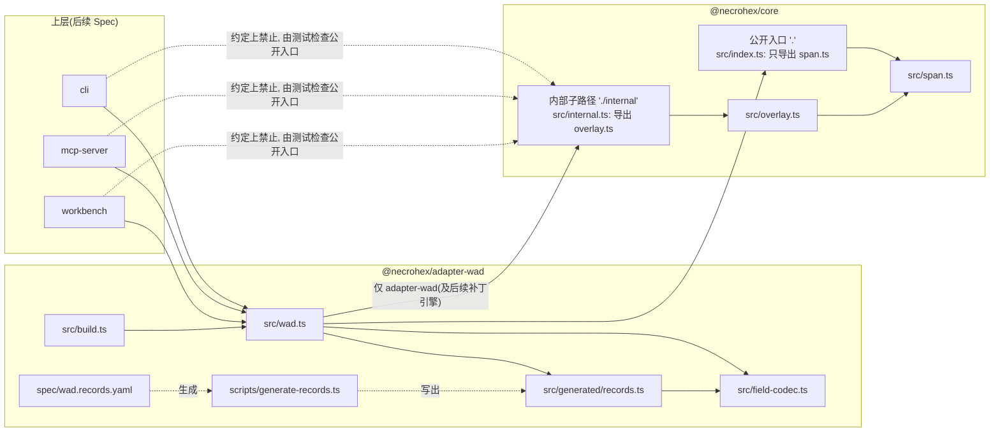
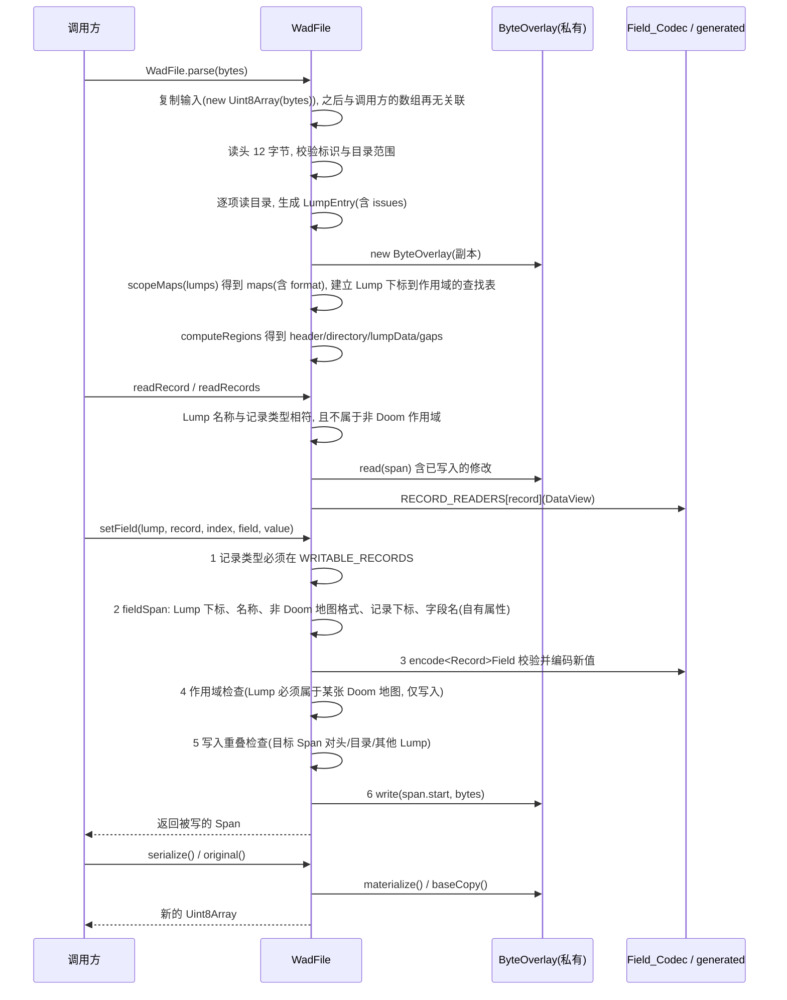

# Design Document

> **这是实现后补写的 Spec。** `wad-roundtrip` 已经在 `packages/core` 和 `packages/adapter-wad` 中实现并有测试覆盖。本文依据代码、测试、同目录 `requirements.md` 以及 `docs/design.md` 第 9 节(WAD 处理)和第 10 节(验证)编写。
>
> **本文已按实际代码同步。** 补写之后,用户对七项差异做出了决定(决定 1 到 7,见"已决定的变更与实施状态"),其中决定 1、2、3、4、7 已经实现(任务 10.1 到 10.4、11.1、11.2,以及 13.11、13.15、13.17),文中按已实现的行为描述它们;决定 5(`PLAYPAL`)是后续可选,决定 6(CI)延后到 `wad-export` 完成之后,二者仍是未实现的目标,文中标注"后续可选"或"延后"。每一项行为都有对应的 `requirements.md` 条目(Requirement 12 到 16 是新增的)和已存在的测试。
>
> 核对方式:阅读源码和测试;运行 `pnpm --filter @necrohex/core test`(2 个文件、5 个用例通过)、`pnpm --filter @necrohex/adapter-wad test`(8 个文件、82 个用例通过,本机 `fixtures/cache/` 中有 `freedoom1.wad` 和 `freedoom2.wad`,整包 IWAD 用例没有被跳过)、`pnpm --filter @necrohex/adapter-wad generate:check` 和 `pnpm -r typecheck`(均通过)。"已知差异与风险"里标注"修复前行为(已复现)"的内容,是修复之前用内存中的临时脚本复现的结果,现在由回归用例固定。
>
> 凡标注"**设计阶段建议,实施前可调整**"的名称(错误类、错误码、方法名、子路径名、常量名、UDMF 成员列表)已按设计实施,名称以代码为准。`UNSUPPORTED_MAP_FORMAT` 与 `REQUIRE_FREEDOOM` 是用户指定的名称。

## Overview

`wad-roundtrip` 是 NecroHex 最底层的字节保真能力,分成三层:

1. **字节层(`@necrohex/core`)**:公开入口 `.` 导出 `Span` 工具;内部入口 `./internal` 导出 `ByteOverlay`。`ByteOverlay` 持有一个基础缓冲,把写入记录为"偏移 + 字节"的列表,`materialize()` 时克隆基础缓冲并应用写入。基础缓冲是私有字段,只能通过 `baseCopy()` 取得副本。core 不认识 WAD。
2. **容器层(`@necrohex/adapter-wad` 的 `wad.ts`)**:`WadFile.parse` 先复制输入,再把它解析为头、目录、`LumpEntry`、`MapScope`(带 `format`)和 `WadRegions`,并把副本交给私有的 `ByteOverlay`。
3. **记录层(`field-codec.ts`、`generated/records.ts`)**:布局来自 `spec/wad.records.yaml`,由 `scripts/generate-records.ts` 生成类型、读取函数和字段编码函数。`WadFile.setField` 是唯一的字节写入入口,目前只允许 `Sector` 和 `Thing`,并且只允许写入属于 Doom 格式地图作用域内的 Lump,不触碰头、目录和其他 Lump 的字节。

核心设计取舍:

- **不重写,只覆盖**。`serialize()` 在没有写入时等于克隆基础缓冲,所以 I-1 对任意输入成立,不依赖解析是否理解内容,也不依赖调用方在 `parse` 之后保持输入不变(`parse` 入口已复制)。
- **解析只读不校验,写入只校验新值**。解析只在无法定位目录时抛出 `WadParseError`,其余异常数据记入 `LumpEntry.issues`。校验只发生在 `Field_Codec.encodeField` 和 `setField` 的结构检查。
- **写入前先证明目标合理**。`setField` 先确认记录类型、位置、新值,再确认目标 Lump 属于一张已识别的 Doom 地图,最后确认目标字段不与头、目录或其他 Lump 的数据重叠。读取没有副作用,所以只有写入需要这些证明。
- **物理区间可追溯**。`LumpEntry` 的 `entrySpan`、`nameSpan`、`dataSpan` 在解析时存储,记录和字段的区间由布局按需计算,`setField` 返回被改写的 `Span`。

## 已决定的变更与实施状态

七项决定的状态如下。每项的修复前行为和实现细节见"已知差异与风险"中的对应条目。

| 决定 | 条目 | 行为(摘要) | 状态 |
| :--- | :--- | :--- | :--- |
| 1 | D-5 | `WadFile.parse` 在入口复制输入;不再暴露内部缓冲;`original()` 返回副本;`baseBuffer` 删除 | 已实现(任务 10.1) |
| 2 | X-1(及 X-2) | `setField` 的目标字段区间与头、目录或其他 Lump 的 `dataSpan` 相交时抛 `WadRecordError`(`WRITE_OVERLAPS_STRUCTURE`),不写入;解析仍不拒绝 | 已实现(任务 10.2) |
| 3 | D-6 | `ByteOverlay` 移出 `@necrohex/core` 公开入口,只经 `@necrohex/core/internal` 提供;测试断言公开入口不导出它。约定级隔离,不是技术隔离 | 已实现(任务 10.3) |
| 4 | X-3、D-9 | `MapScope.format` 为 `doom`/`hexen`/`udmf`;非 Doom 地图的 Lump 经六个记录接口一律抛 `WadRecordError`(`UNSUPPORTED_MAP_FORMAT`);作用域包含 `BEHAVIOR`、`SCRIPTS` 并识别 UDMF 成员。只识别,不解析 | 已实现(任务 11.1、11.2) |
| 5 | D-1 | `PLAYPAL` 不属于本 Spec | 后续可选(本 Spec 不做) |
| 6 | D-8 | GitHub Actions;整包测试下载固定版本 Freedoom 并校验 SHA-256,缓存下载结果;`REQUIRE_FREEDOOM=1` 时缺文件失败 | 延后(`wad-export` 完成后,本次不实施,目前没有 CI 配置) |
| 7 | X-4 | 不属于任何 `MapScope` 的记录 Lump 仍可读取(行为不变);`setField` 对其抛 `WadRecordError`(`OUTSIDE_MAP_SCOPE`),不写入。同一 Lump 落入多个作用域时,有任一非 Doom 作用域则拒绝(`UNSUPPORTED_MAP_FORMAT`),至少有一个 Doom 作用域才允许写入 | 已实现(任务 10.4) |

另有两项不是新决定的修复:F-3(`fieldSpan` 用自有属性判断字段名)已实现(任务 13.11);D-10 的 `Thing` 全部字段和 `name8` 字段写入的属性测试已实现(任务 13.15、13.17)。

### 实施顺序(已按此顺序完成)

1. **第一批**:D-5(10.1)→ X-1(10.2)→ X-4(10.4)→ D-6(10.3)→ F-3(13.11)。这批改动都不依赖地图格式,并且各自带回归用例。10.1、10.2、10.4 改变了 Property 1、2、3 的前提,在各自任务里调整了测试。`WadRecordError` 类在 10.2 创建,10.4 往错误码联合里增加 `OUTSIDE_MAP_SCOPE`,11.2 复用 `UNSUPPORTED_MAP_FORMAT`。
2. **第二批**:13.15(`mapWad` 产出合法 `THINGS`,I-2/I-3 覆盖 `Thing` 全部字段,新增由 `RECORD_LAYOUTS` 推导的字段写入生成器)→ 13.17(`name8` 字段写入的属性测试)。放在第一批之后,是因为第一批改变了 `setField` 的拒绝路径,属性测试以新行为为准。
3. **第三批**:11.1(`MapScope.format`、作用域扩展、UDMF 识别)→ 11.2(六个记录接口的 `UNSUPPORTED_MAP_FORMAT`)。**只做格式判定**:不解析 Hexen 或 UDMF 的记录布局,不做完整 UDMF 解析。
4. **延后**:决定 6(D-8,CI)在 `wad-export` 完成之后再做。决定 5 不在本 Spec 的任何批次内。

**10.4 与 11.2 的衔接**:10.4 实施时 `MapScope.format` 还不存在,规则是"Lump 不属于任何 `MapScope` 则拒绝,属于任一 `MapScope` 则允许"。11.2 把六个记录接口共用的入口检查扩展为"落入任一非 Doom 作用域则抛 `UNSUPPORTED_MAP_FORMAT`",它在 `setField` 的作用域检查之前执行,所以 10.4 的代码不需要修改,规则自然收紧为"至少属于一个 Doom 作用域"。两个条件互斥(落入非 Doom 作用域意味着属于某个作用域),优先级体现在检查顺序上。

## Architecture

### 包与依赖方向

依赖方向遵循项目结构约定:`workbench`、`cli`、`mcp-server` → `adapter-wad` → `core`。本 Spec 只涉及后两个包。`core` 拆成公开入口和内部子路径:公开入口 `.` 只导出 Span 工具,`ByteOverlay` 只经 `@necrohex/core/internal` 提供给 `adapter-wad`。



这一隔离是**约定级**的,不是技术隔离:`package.json` 的 `exports` 只能让公开入口不带出 `ByteOverlay`,但 `@necrohex/core/internal` 这个子路径对 monorepo 内任何依赖 `@necrohex/core` 的包都可解析;声明 `exports` 之后,未列出的包内路径(例如 `@necrohex/core/src/overlay.ts`)按包名导入会被解析器拒绝,但用相对路径(例如 `../../core/src/overlay.ts`)导入不受 `exports` 约束。因此这里不声称"无法绕过",只声称"误用变得显眼,并且公开入口不导出它由测试检查"。

约束落实情况:

- `packages/core/package.json` 只有 `devDependencies`(`fast-check`),没有运行时依赖;`packages/core/tsconfig.json` 继承 `tsconfig.base.json`,其中 `"lib": ["ES2023"]`(不含 DOM)和 `"types": []`(不含 Node 类型),所以 `core/src` 里使用 DOM 或 Node API 会在 `tsc` 阶段失败。已用 `grep` 确认 `core/src` 与 `adapter-wad/src` 没有 `node:` 导入或 `process`、`Buffer` 引用。
- `adapter-wad` 的 `tsconfig.json` 为整个包(含 `src`)开启了 `"types": ["node"]`,这一点见"已知差异与风险"X-8。
- `scripts/generate-records.ts` 与 `test/` 使用 Node(`node:fs`、`yaml`),它们不属于运行时代码。

### 模块划分

| 包 | 文件 | 职责 |
| :--- | :--- | :--- |
| `core` | `src/span.ts` | `Span` 类型(半开区间)与 `span`、`spanLength`、`spansOverlap`、`mergeSpans`、`complementSpans`、`spanWithin` |
| `core` | `src/overlay.ts` | `ByteOverlay`:基础缓冲上的写入覆盖层,基础缓冲私有 |
| `core` | `src/index.ts` | 公开入口,只导出 `span.ts` |
| `core` | `src/internal.ts` | 内部入口,导出 `overlay.ts`,经 `package.json` 的 `exports["./internal"]` 提供给 `adapter-wad` |
| `adapter-wad` | `src/wad.ts` | `WadFile`、`WadParseError`、`WadRecordError`、`LumpEntry`、`MapScope`、`MapFormat`、`WadRegions`、`MAP_DATA_LUMPS`、`HEADER_SIZE`、`DIRECTORY_ENTRY_SIZE`,以及内部的 `scopeMaps`、`collectMembers`、`computeRegions`、模块内常量 `MAP_EXTRA_LUMPS` 与 `UDMF_MAP_LUMPS`(不导出) |
| `adapter-wad` | `src/field-codec.ts` | `FieldLayout`、`RecordLayout`、`decodeName8`、`encodeName8`、`encodeField`、`fieldByteLength` |
| `adapter-wad` | `src/generated/records.ts` | 生成物:五种记录的 `interface`、`<Record>Layout`、`read<Record>`、`encode<Record>Field`,以及 `RecordTypes`、`RecordName`、`RECORD_LAYOUTS`、`RECORD_READERS`、`RECORD_BY_LUMP` |
| `adapter-wad` | `src/build.ts` | `buildWad`:用于测试和夹具的 WAD 构造器 |
| `adapter-wad` | `scripts/generate-records.ts` | 读取 YAML、校验、生成 `records.ts`;`--check` 只比较 |
| `adapter-wad` | `spec/wad.records.yaml` | 记录布局的唯一来源 |
| `adapter-wad` | `scripts/make-freedoom-fixture.ts` | 从完整 Freedoom IWAD 裁出夹具 PWAD(用 `original()` 取一次副本再切片) |
| `adapter-wad` | `src/index.ts` | 导出 `wad.ts`、`build.ts`、`field-codec.ts`、`generated/records.ts` |

### 数据流

`parse → regions / maps / records → setField → ByteOverlay → serialize`:



读取路径永远经过 `ByteOverlay.read`,所以写入后的 `readRecord` 看到新值。任何一步抛错时都尚未调用第 6 步,所以不留痕迹(Requirement 7.10)。步骤 4 是写入专有的:读取接口只经过步骤 2 的非 Doom 格式检查。

## Components and Interfaces

### `@necrohex/core`

```typescript
// span.ts (公开入口)
export interface Span { readonly start: number; readonly end: number } // [start, end)
export function span(start: number, length: number): Span;
export function mergeSpans(spans: readonly Span[]): Span[];            // 丢弃空区间, 合并重叠或相邻, 按起点排序
export function complementSpans(total: number, covered: readonly Span[]): Span[]; // [0,total) 中未覆盖部分, 越界截断
// 另有 spanLength / spansOverlap / spanWithin

// overlay.ts (仅经 @necrohex/core/internal 导出)
export class ByteOverlay {
  constructor(base: Uint8Array);                  // 持有传入的引用, 不复制; 由 WadFile.parse 保证传入的是自己拥有的副本
  get length(): number;                           // 基础缓冲长度
  baseCopy(): Uint8Array;                         // 基础缓冲的副本, 不含写入; 每次返回新数组
  write(offset: number, bytes: Uint8Array): Span; // 记录 bytes 的副本; 越界或非整数偏移抛 RangeError
  read(offset: number, length: number): Uint8Array; // 基础缓冲叠加全部写入, 后写覆盖先写
  get dirty(): boolean;
  dirtySpans(): Span[];                           // mergeSpans(全部写入区间)
  materialize(): Uint8Array;                      // 基础缓冲副本后应用全部写入, 每次返回新数组
}
```

`ByteOverlay` 的写入列表只增不减,不做压缩。`write` 对偏移要求整数且在缓冲内;`read` 只检查负数和上界(见 X-5)。基础缓冲是私有字段 `#base`,没有公开引用。类型层面无法表达"只读的 `Uint8Array`"(TypeScript 没有这种类型),所以"只读"靠"不暴露引用"实现。

#### core 的公开入口与内部子路径(决定 3,已实现)

```jsonc
// packages/core/package.json
"exports": {
  ".": "./src/index.ts",              // 公开入口: 只有 Span 工具
  "./internal": "./src/internal.ts"   // 内部: ByteOverlay, 仅 adapter-wad 使用
}
```

`adapter-wad/src/wad.ts` 的导入拆成两条:`import { complementSpans, mergeSpans, span, spansOverlap, type Span } from "@necrohex/core"` 与 `import { ByteOverlay } from "@necrohex/core/internal"`。`packages/core/test/overlay.test.ts` 的 `ByteOverlay` 从 `../src/internal.ts` 导入。

**限制**:隔离是约定级的。子路径 `@necrohex/core/internal` 对任何依赖 `@necrohex/core` 的包在技术上都可用,`cli`、`mcp-server`、`workbench` 仍然可以写出 `import { ByteOverlay } from "@necrohex/core/internal"` 并绕过 `setField`;相对路径导入也不受 `exports` 约束。能做的是让这种导入变得显眼并被机械检查发现(测试断言公开入口不导出 `ByteOverlay`),不能做到"上层包无法使用 `ByteOverlay`"。任务 10.3 中扫描上层包源码是否出现 `@necrohex/core/internal` 的子项是可选的,未执行(这些包尚不存在)。

### `@necrohex/adapter-wad`:`wad.ts`

```typescript
export type WadKind = "IWAD" | "PWAD";
export type WadParseErrorCode = "TOO_SHORT" | "BAD_IDENT" | "BAD_DIRECTORY";
export class WadParseError extends Error { readonly code: WadParseErrorCode }

export type WadRecordErrorCode = "UNSUPPORTED_MAP_FORMAT" | "OUTSIDE_MAP_SCOPE" | "WRITE_OVERLAPS_STRUCTURE";
export class WadRecordError extends Error { readonly code: WadRecordErrorCode; readonly lumpIndex: number }

export type LumpIssueCode = "NEGATIVE_FIELD" | "DATA_OUT_OF_BOUNDS";
export interface LumpEntry {
  readonly index: number;
  readonly name: string;            // 到第一个 NUL 为止, latin1
  readonly filepos: number;         // int32
  readonly size: number;            // int32
  readonly entrySpan: Span;         // 目录项 16 字节
  readonly nameSpan: Span;          // 目录项内原始名称 8 字节
  readonly dataSpan: Span | null;   // size 为 0, 数据越界或字段为负时为 null
  readonly isMarker: boolean;       // size === 0
  readonly issues: readonly LumpIssueCode[];
}

export type MapFormat = "doom" | "hexen" | "udmf";
export interface MapScope {
  readonly name: string;                         // 标记 Lump 的原始名称
  readonly format: MapFormat;
  readonly markerIndex: number;
  readonly dataIndices: readonly number[];       // 目录顺序
  readonly lumps: Readonly<Record<string, number>>; // 大写数据 Lump 名 -> 下标
}

export interface WadRegions {
  readonly header: Span;                 // [0, 12)
  readonly directory: Span | null;       // numLumps 为 0 时 null
  readonly lumpData: readonly Span[];    // 全部 dataSpan 合并
  readonly gaps: readonly Span[];        // 其余字节, 原样保留
}

export class WadFile {
  readonly kind: WadKind;
  readonly numLumps: number;
  readonly directoryOffset: number;
  readonly lumps: readonly LumpEntry[];
  readonly maps: readonly MapScope[];
  readonly regions: WadRegions;
  static parse(input: Uint8Array): WadFile;      // 入口复制输入
  original(): Uint8Array;                        // 解析时输入的副本(每次调用新数组)
  dirtySpans(): Span[];
  serialize(): Uint8Array;                       // 原始字节 + 全部写入(每次调用新数组)
  lumpBytes(lumpIndex: number): Uint8Array;
  findLump(name: string, from?: number): LumpEntry | undefined;
  findMap(name: string): MapScope | undefined;
  mapLump(map: MapScope, lumpName: string): LumpEntry | undefined;
  recordCount(lumpIndex: number, record: RecordName): number;
  recordSpan(lumpIndex: number, record: RecordName, index: number): Span;
  fieldSpan<K extends RecordName>(lumpIndex: number, record: K, index: number, field: keyof RecordTypes[K] & string): Span;
  readRecord<K extends RecordName>(lumpIndex: number, record: K, index: number): RecordTypes[K];
  readRecords<K extends RecordName>(lumpIndex: number, record: K): RecordTypes[K][];
  setField<K extends RecordName, F extends keyof RecordTypes[K] & string>(
    lumpIndex: number, record: K, index: number, field: F, value: RecordTypes[K][F]): Span;
}
```

要点:

- `WadFile` 的构造函数是 TypeScript `private`,字节写入覆盖层是 `#overlay` 私有字段;公共方法里**没有**接收"偏移 + 字节"的写入方法,`setField` 是唯一写入入口。
- `recordCount` 为 `floor(Lump 大小 / 记录大小)`;`recordSpan` 要求 `(index + 1) * size` 不超过 Lump 大小。
- 六个记录接口(`recordCount`、`recordSpan`、`fieldSpan`、`readRecord`、`readRecords`、`setField`)共用入口检查 `#recordLump`:Lump 下标存在 → Lump 名称与记录类型相符 → 地图格式。`fieldSpan` 再检查记录下标和字段名(自有属性)。

#### 缓冲所有权:复制输入,方法返回副本(决定 1,D-5,已实现)

```typescript
export class WadFile {
  static parse(input: Uint8Array): WadFile;   // 入口 new Uint8Array(input); 之后与调用方的数组再无关联
  original(): Uint8Array;                     // 返回解析时输入的副本(每次调用新数组)
  serialize(): Uint8Array;                    // 返回"原始字节 + 全部写入"的新数组(每次调用新数组)
}
```

- **`original()` 与 `serialize()` 的区别**:`original()` 永远是解析那一刻的字节,不含任何 `setField` 写入;`serialize()` 是原始字节叠加全部写入后的结果。没有写入时两者逐字节相同。两者都返回调用方独占的新数组,修改返回值不会影响 `WadFile`。
- **复制发生在 `parse` 入口,用 `new Uint8Array(input)` 而不是 `input.slice()`**:Node 的 `Buffer.slice` 返回同一内存的视图,不会复制,所以对 `Buffer` 输入 `slice()` 达不到隔离目的;`new Uint8Array(typedArray)` 对任何 `Uint8Array` 子类都复制元素。回归用例"D-5"含 `Buffer` 输入。成本是一次与输入等长的 O(n) 拷贝,峰值内存在 `parse` 期间约为 2n,调用方丢弃输入后回落到 n。输入若是更大 `ArrayBuffer` 上的视图,只复制该视图范围。`original()` 每次调用也是一次 O(n) 拷贝,所以它是用于测试、夹具脚本和差异比较的方法,不适合放进热路径;热路径读取用 `lumpBytes()` 或 `readRecord()`。
- **Web Worker 场景**:工作台可以先把 `ArrayBuffer` 以 transfer 方式移交给 Worker,在 Worker 内再 `parse`,这样主线程与 Worker 之间不会多一次结构化克隆传输;Worker 内部仍会发生 `parse` 入口那一次复制。**本 Spec 不提供"转让所有权"选项**(不提供跳过复制的参数),也就没有"调用方保证不再修改输入"这种需要信任的前提。
- **类型层面的"只读"**:不靠类型标注,而是不暴露内部缓冲的引用:`baseBuffer` 已删除,`ByteOverlay` 的基础缓冲是私有字段。
- 受影响的调用点已调整:`roundtrip.test.ts`、`records.test.ts` 改用 `wad.original()`;`make-freedoom-fixture.ts` 在循环外调用一次 `wad.original()` 再切片。

#### 统一的 `WadRecordError`(决定 2、4、7,已实现)

```typescript
export type WadRecordErrorCode =
  | "UNSUPPORTED_MAP_FORMAT"     // 决定 4: 属于非 Doom 格式地图的 Lump, 六个记录接口都拒绝
  | "WRITE_OVERLAPS_STRUCTURE"   // 决定 2: setField 的目标字段与头/目录/其他 Lump 相交
  | "OUTSIDE_MAP_SCOPE";         // 决定 7: setField 的目标 Lump 不属于任何 MapScope
export class WadRecordError extends Error {
  readonly code: WadRecordErrorCode;
  readonly lumpIndex: number;      // 触发错误的 Lump 下标, 便于上层报告
}
```

- **为什么是一个类**:三种错误都表示"调用本身合法(参数类型和范围都对),但目标 Lump 或字段所在的文件结构不允许这次记录操作"。调用方的处理方式相同(报告并跳过,不重试,不降级),区别只在原因,用 `code` 区分即可,与现有 `WadParseError` 的 `code` 做法一致。若将来出现需要携带不同附加数据的错误(例如重叠错误需要返回冲突的 Span 列表),再拆;现在三者只需要 `lumpIndex`。
- **`OUTSIDE_MAP_SCOPE` 与 `LUMP_NOT_IN_MAP` 的取舍**:选 `OUTSIDE_MAP_SCOPE`。它与类型名 `MapScope` 对应,说明的是"按本层的作用域规则不在地图内",而不是对真实地图的断言;作用域识别只是名称启发式,被未识别 Lump 截断的真实地图的数据 Lump 也会得到这个码。
- 参数类错误保持原样:Lump 下标不存在仍是 `RangeError`,Lump 名称与记录类型不符仍是 `TypeError`,新值非法仍是 `TypeError`/`RangeError`。`WadRecordError` 只承载上述三种"文件结构拒绝"。

#### 写入重叠检查(决定 2,X-1,已实现)

**术语**:目标字段 Span 记为 T,即 `fieldSpan(lumpIndex, record, index, field)` 的结果(长度 ≥ 2,非空)。区间为半开区间 `[start, end)`,"相交"沿用 core 的 `spansOverlap(a, b) = a.start < b.end && b.start < a.end`,因此首尾相接(`a.end === b.start`)**不算**相交。

**规则**:以下任一条成立,`setField` 抛 `WadRecordError("WRITE_OVERLAPS_STRUCTURE")`:

1. `spansOverlap(T, regions.header)`;
2. `regions.directory !== null` 且 `spansOverlap(T, regions.directory)`;
3. 存在 Lump `j ≠ lumpIndex`,其 `dataSpan !== null` 且 `spansOverlap(T, dataSpan_j)`。

要点:

- 只比较目标**字段**区间,不比较被写 Lump 的整个 `dataSpan`。被写 Lump 与别的区域相交,但目标字段本身不落在相交处时,这次写入只触碰自己的字节,允许写入。这样不会因为一个无关字段的重叠而拒绝全部写入,同时每个被拒绝的写入都对应一段确实会改写别人字节的区间。
- 与自己所在 Lump 的 `dataSpan` 比较没有意义(T 一定在其中),所以第 3 条排除 `j = lumpIndex`。两个目录项指向完全相同的数据区间时,对其中一个的写入会命中另一个而被拒绝(不替用户决定"哪一个才是真正的 `SECTORS`")。
- `dataSpan === null` 的 Lump(标记、负数字段、越界数据)不参与比较。
- 解析阶段不变:重叠数据仍能 `parse`,不抛错,`LumpEntry.issues` 也不新增代码(Requirement 2.5 保持)。拒绝只发生在写入时。
- **成本**:每次 `setField` 为 O(Lump 数)的线性扫描。真实 WAD 有几百到几千个 Lump,补丁一次写几百个字段,总量可接受;若成为热点,可在 `parse` 时预先对非空 `dataSpan` 排序以二分查找,本 Spec 不要求。
- **不留痕迹**:拒绝发生在 `write` 之前,所以 `dirtySpans()` 与 `serialize()` 保持调用前的结果,满足 Requirement 7.10。

#### 地图格式与非 Doom 地图的访问限制(决定 4,X-3、D-9,已实现)

```typescript
export type MapFormat = "doom" | "hexen" | "udmf";
```

- **判定**:作用域内含 `TEXTMAP` 则 `udmf`;否则含 `BEHAVIOR` 则 `hexen`;其余 `doom`。作用域的识别规则见 Data Models。
- **受限接口**:`recordCount`、`recordSpan`、`fieldSpan`、`readRecord`、`readRecords`、`setField`。若 `lumpIndex` 属于任一非 Doom 格式地图的 `dataIndices`,则抛 `WadRecordError("UNSUPPORTED_MAP_FORMAT")`。检查顺序在"Lump 下标存在"与"Lump 名称与记录类型相符"之后。若病态输入使同一 Lump 落入多个作用域,只要其中一个是非 Doom 格式就拒绝,不在多个格式之间猜测。
- **不受限的接口**:`serialize()`、`original()`、`lumpBytes()`、`maps`、`regions`、`findLump`、`findMap`、`mapLump`、`dirtySpans()`。非 Doom 地图可以被完整解析、往返和导出为字节,只是不能按 Doom 布局解释其记录。因此 I-1 对这类 WAD 照常成立。
- **范围**:只做格式判定。不解析 Hexen 的 20 字节 `Thing` 与 16 字节 `Linedef`,不解析 `TEXTMAP` 文本。
- **UDMF 作用域内几乎不可能出现记录 Lump 名**(`THINGS`、`SECTORS` 等不在 UDMF 成员列表里,出现即结束作用域),所以 `UNSUPPORTED_MAP_FORMAT` 在实际中主要拦截 Hexen。规则仍按格式而不是按"是否 Hexen"写,是为了不依赖这个巧合。

#### 不属于任何地图作用域的 Lump:可读不可写(决定 7,X-4,已实现)

- **读取不变**。Lump 不属于任何 `MapScope`(例如 `THINGS`、`SECTORS` 出现在地图作用域之外,或作用域被未识别 Lump 提前截断后落在作用域之外的数据 Lump),`recordCount`、`recordSpan`、`fieldSpan`、`readRecord`、`readRecords` 仍按 Lump 名对应的 Doom 布局工作,不抛 `WadRecordError`。
- **写入拒绝**。`setField` 对这类 Lump 抛 `WadRecordError`,`code` 为 `OUTSIDE_MAP_SCOPE`,不写入、不留痕迹。实现上 `WadFile` 在构造时建立"Lump 下标 → 以它为数据 Lump 的 `MapScope` 列表"的查找表 `#scopesByLump`,没有条目表示不属于任何作用域。
- **多个作用域**。同一 Lump 落入多个作用域(病态输入)时:只要其中一个是非 Doom 格式,就拒绝(`UNSUPPORTED_MAP_FORMAT`);落入至少一个 Doom 作用域且没有非 Doom 作用域,才允许写入。不属于任何作用域才是 `OUTSIDE_MAP_SCOPE`。三种情形互斥。按现有扫描规则(每个数据 Lump 只跟随最近的标记,Doom 路径遇到 `TEXTMAP` 即结束,UDMF 路径从 `TEXTMAP` 起收集),构造不出同一 Lump 落入多个 `dataIndices` 的输入,所以这条规则是防御性的,没有测试。

**为什么读写不对称**:读取没有副作用,Doom 布局是合理的默认解释,读错最多得到一份无意义的预览,调用方可以丢弃;而 `setField` 会改变字节,必须能证明目标属于一张已识别的 Doom 地图,才能确信记录大小和字段偏移与文件实际布局一致。"拒绝猜测"的原则在写入侧适用,在只读侧不必这么严:读取不会让文件变得更糟。

**如实写出的剩余风险**:

1. **作用域识别是名称启发式,误判方向是安全的**。被未识别 Lump 截断的真实地图(例如某个源端口在 `SECTORS` 之前插入了 `GL_VERT` 或 `LEAFS` 之类不在成员列表里的 Lump),其后的数据 Lump 会落在作用域之外,从"可读可写"变成"可读不可写"。代价是合法补丁在这类 WAD 上被拒绝(调用方得到 `OUTSIDE_MAP_SCOPE`),而不是错误写入。本 Spec 不提供绕过这个拒绝的选项。
2. **读取仍可能把非 Doom 布局的孤立 Lump 按 Doom 布局解释**。名为 `THINGS` 的孤立 Lump 若实际是 Hexen 的 20 字节记录,`readRecords` 会得到错误的条数和内容。这是只读风险:不改变任何字节,但上层若据此做展示或规划,应当知道它不来自一张已识别的地图。
3. 决定 7 关闭的是"写入未归入作用域的 Lump"这个洞;它不改善作用域识别本身的覆盖面。

#### `setField` 的检查顺序

| 步骤 | 检查 | 失败时 | 备注 |
| :--- | :--- | :--- | :--- |
| 1 | 记录类型在 `WRITABLE_RECORDS` | `Error("<record> records are read-only")` | |
| 2 | `fieldSpan`:Lump 下标 → Lump 名称与记录类型 → **非 Doom 地图格式** → 记录下标 → 字段名(自有属性) | `RangeError` / `TypeError` / `WadRecordError("UNSUPPORTED_MAP_FORMAT")` / `RangeError` / `RangeError` | 前三项在 `#recordLump` 中,由六个记录接口共用;落入任一非 Doom 作用域即拒绝 |
| 3 | `encode<Record>Field`:新值类型与范围 | `TypeError` / `RangeError` | |
| 4 | **作用域检查**:Lump 至少属于一个 `MapScope`(此时已排除非 Doom,所以等价于"至少属于一个 Doom 作用域") | `WadRecordError("OUTSIDE_MAP_SCOPE")` | 仅 `setField`,读取接口没有这一步 |
| 5 | 写入重叠检查:目标字段 Span 对头、目录、其他 Lump | `WadRecordError("WRITE_OVERLAPS_STRUCTURE")` | |
| 6 | `ByteOverlay.write` | `RangeError`(不应可达) | |

顺序的理由:

- **参数类错误先于结构类拒绝**。步骤 1 到 3 报告的是调用方的错(记录类型、下标、字段名、新值),步骤 4、5 报告的是文件的问题。调用方先修好自己的参数,再得知文件不允许这次写入。
- **非 Doom 格式先于"不在作用域内"**。`UNSUPPORTED_MAP_FORMAT` 与读取共用,在步骤 2 内就抛出;`OUTSIDE_MAP_SCOPE` 只有 `setField` 用,在步骤 4 才抛出。
- **作用域检查先于重叠检查**。先确认目标属于一张已识别的 Doom 地图,再比较它的字节几何;不在作用域内的 Lump 即便同时与头相交,报告的也是 `OUTSIDE_MAP_SCOPE`。因此 X-1 的回归 WAD 必须让 `SECTORS` 在作用域内,否则先触发新错误,掩盖重叠错误。该顺序目前没有直接测试(属性形式是可选任务 13.18)。

### `@necrohex/adapter-wad`:`field-codec.ts`

```typescript
export type FieldType = "int16" | "uint16" | "name8";
export interface FieldLayout { readonly offset: number; readonly type: FieldType; readonly count: number }
export interface RecordLayout { readonly name: string; readonly lump: string; readonly size: number; readonly fields: Readonly<Record<string, FieldLayout>> }

export function decodeName8(view: DataView, offset: number): string;      // 读取: 到第一个 NUL, latin1, 不校验
export function encodeName8(value: unknown, label: string): Uint8Array;  // 写入: 1~8 个 0x21..0x7e 字符, NUL 填充到 8 字节
export function encodeField(layout: FieldLayout, label: string, value: unknown): Uint8Array;
```

`encodeField` 的校验规则:

| 字段类型 | 合法新值 | 非法时 |
| :--- | :--- | :--- |
| `int16` | 整数,-32768..32767 | 非整数或非 number:`TypeError`;越界:`RangeError` |
| `uint16` | 整数,0..65535 | 同上 |
| `name8` | 字符串,长度 1..8,每个字符码点在 0x21..0x7e | 非字符串:`TypeError`;长度或字符非法:`RangeError` |
| `count > 1` 的字段 | 长度恰为 `count` 的数组,逐项按元素类型校验 | 长度不符:`TypeError` |

整数一律小端编码。`encodeField` 只在写入新值时调用,读取路径从不校验。

### `@necrohex/adapter-wad`:记录层生成

`spec/wad.records.yaml` 的结构:`records.<Name>.{lump, size, fields[]}`,字段为 `{ name, type, count? }`,`type` 取 `int16`、`uint16`、`name8`,`count` 为不小于 2 的整数。字段按声明顺序紧密排列。

`scripts/generate-records.ts` 流程:`parse(yaml)` → `validate`(任何不合规抛出以 `wad.records.yaml:` 开头的 `Error`)→ `generateRecordsSource(yamlText)`(纯函数,返回字符串)→ 写入 `src/generated/records.ts`;带 `--check` 时只比较,不一致或文件缺失就向标准错误输出提示并以状态码 1 退出。`pnpm build` 在 `tsc` 之前先跑 `generate:check`,`test/records.test.ts` 也断言生成物与 YAML 同步。

当前 YAML 定义的记录:

| 记录 | Lump | 字节数 | 字段(按偏移顺序) | 可写 |
| :--- | :--- | :--- | :--- | :--- |
| `Sector` | `SECTORS` | 26 | `floorheight` i16 @0,`ceilingheight` i16 @2,`floorpic` name8 @4,`ceilingpic` name8 @12,`lightlevel` i16 @20,`special` i16 @22,`tag` i16 @24 | 是 |
| `Thing` | `THINGS` | 10 | `x` @0,`y` @2,`angle` @4,`type` @6(均 i16),`flags` u16 @8 | 是 |
| `Linedef` | `LINEDEFS` | 14 | `v1` u16 @0,`v2` u16 @2,`flags` u16 @4,`special` i16 @6,`tag` i16 @8,`sidenum` i16×2 @10 | 否 |
| `Sidedef` | `SIDEDEFS` | 30 | `textureoffset` @0,`rowoffset` @2(i16),`toptexture` @4,`bottomtexture` @12,`midtexture` @20(name8),`sector` i16 @28 | 否 |
| `Vertex` | `VERTEXES` | 4 | `x` @0,`y` @2(i16) | 否 |

"可写"一栏不在 YAML 中,由 `wad.ts` 的 `WRITABLE_RECORDS` 决定(见 X-6)。

### `@necrohex/adapter-wad`:`build.ts`

`buildWad({ kind, lumps, gapBeforeDirectory?, trailing? })` 把 `LumpInput`(含 `name`/`nameBytes`、`data`、`gapBefore`、`markerFilepos`)拼成容器字节,目录放在所有 Lump 数据之后。它只用于测试和夹具脚本,但目前从包入口导出(见 X-7)。

## Data Models

### 容器布局

| 区域 | 位置 | 内容 |
| :--- | :--- | :--- |
| 头 | `[0, 12)` | 4 字节标识(`IWAD`/`PWAD`),`numLumps` int32,`directoryOffset` int32,均小端 |
| 目录 | `[directoryOffset, directoryOffset + numLumps * 16)` | 每项 16 字节:`filepos` int32,`size` int32,8 字节原始名称 |
| Lump 数据 | 各 `dataSpan` | 由目录项指向 |
| 间隙 | 其余字节 | 原样保留 |

### 目录项分类

`parse` 对每个目录项按下表生成 `LumpEntry`:

| 条件 | `issues` | `dataSpan` | `isMarker` |
| :--- | :--- | :--- | :--- |
| `filepos < 0` 或 `size < 0` | `["NEGATIVE_FIELD"]` | `null` | `size === 0` |
| `size === 0` 且 `filepos >= 0` | `[]` | `null` | `true` |
| `size > 0`、`filepos >= 0` 且 `filepos + size <= 输入长度` | `[]` | `[filepos, filepos + size)` | `false` |
| `size > 0`、`filepos >= 0` 且 `filepos + size > 输入长度` | `["DATA_OUT_OF_BOUNDS"]` | `null` | `false` |

`dataSpan` 不检查是否与头、目录或其他 Lump 相交,所以重叠数据能被解析。解析不检查、不拒绝、不新增 `LumpIssueCode`;`setField` 在写入前按"写入重叠检查"规则拒绝,见 Components。

### 地图作用域

**常量**。`MAP_DATA_LUMPS` 保持 10 个标准名称不变(值和导出名都没变,`freedoom.test.ts` 里"`Object.keys(m.lumps)` 等于 `MAP_DATA_LUMPS`"的断言因此不用改)。`wad.ts` 内另有两个不导出的模块常量:

| 常量 | 内容 | 用途 |
| :--- | :--- | :--- |
| `MAP_DATA_LUMPS`(导出,不变) | 10 个 Doom 数据 Lump | 判定 Doom/Hexen 路径"至少含一个基础数据 Lump";Doom 格式的基础成员 |
| `MAP_EXTRA_LUMPS` | `BEHAVIOR`、`SCRIPTS` | 与 `MAP_DATA_LUMPS` 合并构成 Doom/Hexen 路径的成员集合 |
| `UDMF_MAP_LUMPS` | `TEXTMAP`、`ZNODES`、`REJECT`、`DIALOGUE`、`BEHAVIOR`、`SCRIPTS`、`BLOCKMAP`、`ENDMAP` | UDMF 路径的成员集合 |

**扫描规则**(`scopeMaps`,对每个下标 `i`):

1. **UDMF 路径**:`lumps[i+1]` 的名称(大写)为 `TEXTMAP` 时,`lumps[i]` 是候选标记,名称不受 `ExMy`/`MAPxx` 限制,也不要求 `size === 0`(与 D-7 保持一致,不新增硬条件)。从 `i+1` 起收集成员,成员集合为 `UDMF_MAP_LUMPS`;遇到非成员或本地图内已出现过的名称就结束;**收集到 `ENDMAP` 时把它加入后立即结束**。`TEXTMAP` 必然是第一个成员,所以 `dataIndices` 非空。`format = "udmf"`。
2. **Doom/Hexen 路径**(名称匹配 `^(E[1-9]M[1-9]|MAP\d\d)$` 且下一个 Lump 不是 `TEXTMAP`):成员集合为 `MAP_DATA_LUMPS ∪ MAP_EXTRA_LUMPS`;遇到非成员(包括 `TEXTMAP`)或重复名称就结束。要求**至少含一个 `MAP_DATA_LUMPS` 中的 Lump** 才生成 `MapScope`;只含 `BEHAVIOR`/`SCRIPTS` 的候选不成图,这样现有输入的识别结果不因新增成员而增多。`format = "hexen"` 当且仅当收集到 `BEHAVIOR`,否则 `"doom"`。
3. 生成 `MapScope` 时写入 `format`、`dataIndices`(目录顺序)和 `lumps`(大写名 → 下标)。成员收集由 `collectMembers` 完成,键查找用 `Object.hasOwn`。

若 UDMF 作用域缺少 `ENDMAP`,仍按 UDMF 识别,按现有规则在第一个非成员或重复名称处结束,`MapScope` 不为此新增字段;是否因缺少 `ENDMAP` 拒绝导出,留给 `wad-export` 判断。

**对现有输入保持不变**:夹具(`freedoom2-map01-02.wad`)以及 Freedoom 的 IWAD 中,`MAP01`、`MAP02` 之后只有 10 个标准 Doom 数据 Lump,没有 `BEHAVIOR`、`SCRIPTS` 或 `TEXTMAP`,所以新规则收集到的 Lump 与旧规则相同,`format` 都是 `"doom"`。`freedoom.test.ts` 用内联保存的旧规则(`helpers.ts` 的 `legacyMaps`)逐项比较夹具和本地 IWAD 的 `maps`。会改变识别结果的只有:带 `BEHAVIOR`/`SCRIPTS` 的地图(作用域变长)、`TEXTMAP` 开头的地图(新识别)。

**对 PWAD 导出的意义**:`dataIndices` 现在包含 `BEHAVIOR`、`SCRIPTS`,以及 UDMF 的 `ZNODES`、`DIALOGUE` 等成员和 `ENDMAP`,`wad-export` 复制"标记加 `dataIndices`"时不会漏掉它们。

**限制(如实说明)**:以上是**名称启发式**,不能保证识别所有来源的 UDMF/Hexen WAD。可能漏判或误判的情形包括:UDMF 地图中插入了成员列表之外的 Lump(例如某些源端口的 `GL_*` 或 `LIGHTMAP`),作用域会在该处提前结束;Hexen 地图的 `BEHAVIOR` 不紧跟在基础数据 Lump 之后;名称恰好与成员名相同但并非地图成员的 Lump。这类情形下,落在作用域之外的数据 Lump 变成"可读不可写":读取仍按 Lump 名当作 Doom 记录(只读风险),`setField` 抛 `OUTSIDE_MAP_SCOPE`。本 Spec 只提供"能识别时就拒绝",以及"识别不了的数据 Lump 不能写入";不提供"识别不了时读取也安全"。

### 区域划分

`computeRegions` 得到 `header = [0,12)`;`directory` 为 `[dirOfs, dirOfs + numLumps*16)`(`numLumps` 为 0 时 `null`);`lumpData = mergeSpans(全部 dataSpan)`;`gaps = complementSpans(总长, [header, directory, ...lumpData])`。因此 `gaps` 与其余三者不相交,四者并集等于 `[0, 总长)`;但 `header`、`directory`、`lumpData` 三者彼此可以重叠。

## Error Handling

| 位置 | 条件 | 行为 | 是否改变状态 |
| :--- | :--- | :--- | :--- |
| `WadFile.parse` | 输入少于 12 字节 | `WadParseError("TOO_SHORT")` | 无 |
| `WadFile.parse` | 标识不是 `IWAD`/`PWAD` | `WadParseError("BAD_IDENT")` | 无 |
| `WadFile.parse` | `numLumps < 0`;或 `numLumps > 0` 且目录偏移为负或目录超出输入 | `WadParseError("BAD_DIRECTORY")` | 无 |
| `WadFile.parse` | 目录项 `filepos`/`size` 为负,或数据越界 | 不抛出,记入 `LumpEntry.issues`,`dataSpan = null` | 无 |
| `WadFile` 的 Lump 访问 | `lumpIndex` 不存在 | `RangeError` | 无 |
| `WadFile` 记录访问 | Lump 名称与记录类型不符 | `TypeError` | 无 |
| `recordCount`/`recordSpan`/`fieldSpan`/`readRecord`/`readRecords`/`setField` | Lump 属于非 Doom 格式(`hexen`/`udmf`)地图的作用域 | `WadRecordError`,`code` 为 `UNSUPPORTED_MAP_FORMAT` | 无 |
| `recordSpan`/`readRecord`/`setField` | 下标非整数、为负或超出完整记录 | `RangeError` | 无 |
| `fieldSpan`/`setField` | 字段名不是布局自有字段(包括继承自 `Object.prototype` 的名称) | `RangeError` | 无 |
| `setField` | 记录类型不是 `Sector`/`Thing` | `Error("<record> records are read-only")` | 无 |
| `Field_Codec` | 类型或取值非法 | `TypeError`/`RangeError`(见上表) | 无,尚未调用 `write` |
| `setField` | Lump 不属于任何 `MapScope`(落入任一非 Doom 作用域的情形先由 `UNSUPPORTED_MAP_FORMAT` 拒绝)。读取接口不受影响 | `WadRecordError`,`code` 为 `OUTSIDE_MAP_SCOPE`;发生在新值编码之后、写入重叠检查之前 | 无,尚未调用 `write` |
| `setField` | 目标字段 Span 与 `regions.header`、`regions.directory` 或自己以外任一 Lump 的 `dataSpan` 相交 | `WadRecordError`,`code` 为 `WRITE_OVERLAPS_STRUCTURE` | 无,尚未调用 `write` |
| `ByteOverlay.write` | 偏移非整数、为负或写入超出缓冲 | `RangeError` | 无,不记录 |
| `ByteOverlay.read` | 偏移或长度为负,或超出缓冲 | `RangeError` | 无 |
| `generate-records.ts` | YAML 不合规 | `Error`,消息以 `wad.records.yaml:` 开头 | 不写文件 |
| `generate-records.ts --check` | 生成物过期或缺失 | 标准错误输出提示,`process.exit(1)` | 不写文件 |

策略:

- **解析阶段尽量不抛**。只有无法定位目录或标识不明时才抛 `WadParseError`,让 I-1 对非常规数据也成立。
- **写入阶段先校验、后落盘**。校验失败或结构拒绝(`OUTSIDE_MAP_SCOPE`、`WRITE_OVERLAPS_STRUCTURE`)时 `ByteOverlay` 没有被触碰,`dirtySpans()` 与 `serialize()` 保持原样。参数类错误排在结构类拒绝之前。
- **错误类型区分调用方错误与数据问题**:`TypeError`/`RangeError` 表示调用参数不合法;`WadParseError` 表示输入文件无法解析;`LumpEntry.issues` 表示可继续使用的数据问题;`WadRecordError` 表示"参数合法,但文件结构不允许这次记录操作",带 `code`。解析阶段仍只记录问题、不因重叠或非 Doom 格式拒绝文件。

## binary-safety 规则逐项核对

下表依据工作区的 binary-safety 规则,说明本 Spec 覆盖的实现如何满足这些规则。

| 规则 | 状态 | 当前实现 | 剩余缺口 |
| :--- | :--- | :--- | :--- |
| 无改动时序列化与输入逐字节相同 | 满足 | `serialize()` = 基础缓冲副本 + 写入;无写入时等于输入。`parse` 入口复制输入,`baseBuffer` 已删除,I-1 不再依赖调用方在 `parse` 之后保持输入不变。`roundtrip.test.ts`、`regression.test.ts`、`freedoom.test.ts` 验证 | 无 |
| 补丁只改回执中的字节区间 | 本层满足 I-3 | `setField` 返回被写 `Span`;属性测试验证变化字节都在返回的 Span 内。`setField` 拒绝触碰头、目录或其他 Lump 的写入(`WRITE_OVERLAPS_STRUCTURE`),并且只允许写入属于某张 Doom 地图作用域的 Lump(`OUTSIDE_MAP_SCOPE`) | 回执层的 I-3 尚未建立(D-4),属于 `semantic-patch` |
| 保留未知 Lump、间隙字节、原始名称字节 | 满足 | 所有写入只经过 `setField` 的字段区间;`nameSpan` 暴露完整 8 字节;`gaps` 不被写入;写入重叠检查阻止改写目录里的原始名称。`name8` 字段写入会把整个 8 字节字段重写为"名称 + NUL 填充",原字段内 NUL 之后的杂字节会被覆盖,这属于目标字段本身 | 无 |
| MCP 和公共 API 不接受裸偏移与字节写入 | `WadFile` 满足;`core` 为约定级隔离 | `WadFile` 公共方法没有裸写入;`#overlay` 私有;`ByteOverlay` 不在 `@necrohex/core` 公开入口,只经 `@necrohex/core/internal` 提供,基础缓冲私有 | 子路径与相对路径导入仍可绕过(D-6 限制);`buildWad` 从包入口导出(X-7,未做决定) |
| 不覆盖源文件 | 满足(本层无文件 I/O) | `src/` 没有文件系统调用,`serialize()` 只返回新数组 | 落盘由 `cli`/`mcp-server` 负责;`scripts/make-freedoom-fixture.ts` 不检查输入输出路径是否相同 |
| 只校验新值,解析不拒绝历史数据 | 满足,有一处灰区 | 读取路径不校验;`parse` 仅在 `TOO_SHORT`、`BAD_IDENT`、`BAD_DIRECTORY` 时抛出;`encodeField` 只校验新值;写入重叠和作用域检查只在写入时发生 | 目录超出文件的截断文件会被 `BAD_DIRECTORY` 拒绝。这属于"无法定位目录",与 `docs/design.md` 第 8 节的表述一致;结构护栏(`ceilingheight >= floorheight`、引用完整性)不在本层 |
| 相似候选不猜测,返回 `CONFLICT_AMBIGUOUS` | 不在本 Spec 范围 | 重定位属于 `semantic-patch`。本层与"不猜测"相关的是 Doom 布局假设:已识别为 Hexen/UDMF 的地图,记录接口抛 `UNSUPPORTED_MAP_FORMAT`;未归入任何作用域的 Lump 读取仍按 Lump 名解释(只读风险,如实保留),写入一律抛 `OUTSIDE_MAP_SCOPE`,所以猜测不会变成字节改动 | `scopeMaps` 的名称启发式(D-7)未做决定 |
| PWAD 必须含标记 Lump 和该地图全部数据 Lump | 未实现 | 导出不在本实现中(D-3) | `MapScope.dataIndices` 现在包含 `BEHAVIOR`、`SCRIPTS` 和 UDMF 成员(D-9 已解决),未来导出不会因此漏掉它们;识别仍是启发式,不保证覆盖所有来源的 WAD |
| 默认保护(玩家出生点、传送目标、钥匙、Boss、非零扇区特效) | 不在本层 | `setField` 对 `Thing.type`、`Sector.special` 接受任意合法 `int16` | 保护必须在 `semantic-patch` 里、`setField` 之前执行;任何直接调用 `setField` 的代码都会绕过。`ByteOverlay` 移出公开入口让绕过 `setField` 直接用 `ByteOverlay` 变得显眼,但不阻止 |
| 属性测试同时覆盖生成数据与真实 Freedoom 夹具;发现的 bug 保留为回归用例 | 部分满足 | 见 Testing Strategy。`regression.test.ts` 保存了 D-5、X-1、X-4、D-6、F-3、X-3 的回归用例 | 整包 IWAD 依赖本地 cache(D-8,延后);`Sector` 其余整数字段没有属性测试(D-10 剩余) |

## Correctness Properties

*A property is a characteristic or behavior that should hold true across all valid executions of a system-essentially, a formal statement about what the system should do. Properties serve as the bridge between human-readable specifications and machine-verifiable correctness guarantees.*

### 属性反思

按验收标准做完 prework 后,合并了互相蕴含或可共用同一个生成器的条目:

- Requirement 9.1 到 9.5 与 12.1 到 12.5 合并为 Property 1;3.6 作为 Property 1 与 Property 3 的推论,不单列。
- Requirement 10.1 与 10.2 以及 13 的重叠拒绝合并为 Property 2,因为两者共用同一个生成器和同一个"重新解析后相等"的断言。
- Requirement 11.1 到 11.5 与 7.3 合并为 Property 3;`dirtySpans` 的断言按"并集"表述(见 F-2)。
- Requirement 2.2、2.3、2.4、3.1 合并为"目录项分类",与名称/区间几何(1.3、3.2、3.3)合为 Property 5。
- Requirement 4.1 到 4.5 与 15.1 到 15.5 合并为与参考实现比较的 Property 7;4.6 到 4.8 保持为例子测试。
- Requirement 7.5 到 7.8 与 7.10 合并为 Property 9。
- 决定 4 的"非 Doom 地图拒绝按 Doom 布局访问"是 Property 13,决定 7 的"不在任何作用域内的 Lump 可读不可写"是 Property 14。**决定 7 为什么不并入 Property 13**:Property 13 的对象是"落在非 Doom 作用域内的 Lump",读写都被拒绝;决定 7 的对象是"不在任何作用域内的 Lump",读取放行、写入拒绝,断言形状不同(读写不对称),生成器也不同(无标记的 WAD、被未识别 Lump 截断的地图,而不是格式变体)。合并会让一个属性同时承载"拒绝读写"和"放行读取"两种相反的断言。
- Requirement 14(`ByteOverlay` 的内部子路径)是基于例子的检查,没有输入空间可量化,记为 Property 15。

不适合属性测试的条目:Requirement 5.1、5.3、5.6 到 5.10(文件系统副作用、配置检查或生成源码的存在性,用例子、集成和冒烟测试)、7.4、7.11、4.6 到 4.8、1.2。

下面的每个属性给出:断言、关联需求、测试落点(测试文件、生成器、Freedoom 夹具)、缺口。

### Property 1: I-1 无损往返

*For any* 合法容器字节 B(包括 `buildWad` 生成的任意 Lump 序列、间隙和尾部字节,目录项被任意改写但头部仍能定位目录的变体,以及 Freedoom 夹具和本地完整 IWAD)和 *any* 对 B 本身、对 `serialize()` 返回值、对 `original()` 返回值、对 `lumpBytes()` 返回值的任意修改序列(修改发生在 `parse` 之后、任意位置、任意取值):令 B₀ 为 `parse` 之前 B 的拷贝,则 `wad.serialize()` 与 B₀ 逐字节相同,`wad.original()` 与 B₀ 逐字节相同,`dirtySpans()` 为空。"调用方不得修改输入"不再是前提:它由 `parse` 入口复制保证。

**Validates: Requirements 9.1, 9.2, 9.3, 9.4, 9.5, 3.6, 12.1, 12.2, 12.3, 12.4, 12.5**

- 测试文件:`packages/adapter-wad/test/roundtrip.test.ts`("I-1 无损往返"第 1 个用例,300 次;"serialize 与 original 返回副本";"parse 之后对输入、serialize()、original()、lumpBytes() 返回值的任意修改…",300 次;"损坏目录项的合法容器仍无损往返",300 次);`regression.test.ts`("D-5",含 `Buffer` 输入、`"baseBuffer" in wad` 为 `false`)。
- 生成器:`test/arbitraries.ts` 的 `wadBytes`(`lumpInput` 序列、`gapBeforeDirectory`、`trailing`,名称含常见名与随机名,原始名称字节含 NUL 之后的杂字节,标记 Lump 的 `markerFilepos` 为任意值);损坏目录项用例在 `wadBytes` 基础上随机改写目录字节;修改序列由 `{ target: input | serialize | original | lumpBytes, at, value }` 组成。
- Freedoom 夹具:`test/freedoom.test.ts` 的"I-1 逐字节往返"(`fixtures/freedoom/freedoom2-map01-02.wad`);`describe.each(cached)` 中针对 `fixtures/cache/freedoom1.wad`、`freedoom2.wad` 的"I-1 逐字节往返"(本地存在时才运行,见 D-8)。
- 缺口:损坏目录用例没有断言 `issues`(可选任务 13.16)。

### Property 2: I-2 结构对偶

*For any* 合法容器 A(包括 `SECTORS` 目录项的 `dataSpan` 指向文件头、目录或其他 Lump 的变体)和 *any* `setField` 调用序列,每次调用恰好是下面两种结果之一:

1. **被接受**:当且仅当目标字段 Span T 不与 `regions.header`、`regions.directory` 以及自己以外任一 Lump 的 `dataSpan` 相交(判定由测试里独立编写的参考实现 `touchesStructure` 给出,只用头部原始数值和目录项的 `filepos`/`size`,不复用 `WadFile` 的内部函数)。接受之后的全部写入完成,则 `WadFile.parse(A.serialize())` 的结构摘要与 A 相等,各记录与 A 通过 `readRecords` 读到的相等。
2. **被拒绝**:其余情形抛出 `WadRecordError`,`code` 为 `WRITE_OVERLAPS_STRUCTURE`,并且调用前后 `dirtySpans()` 与 `serialize()` 的结果相同(无痕迹)。

"被写 Lump 的 `dataSpan` 不与头或目录相交"不再是属性的前提,而是由 API 保证:任何被接受的写入都不会触碰头、目录或其他 Lump 的字节。

**与决定 7 的关系**:上面的"被接受/被拒绝"二分只对**被写 Lump 位于 Doom 地图作用域内**的调用成立。位于作用域之外的 Lump 在到达重叠检查之前就被 `OUTSIDE_MAP_SCOPE` 拒绝,这类调用由 Property 14 覆盖,**不属于本属性**。本属性的生成器保证被写 Lump 在 Doom 地图作用域内:`mapWad`(标记加 10 个数据 Lump,`before`/`after` 夹杂的 Lump 以 `X` 开头不会形成或打断作用域)满足这一点,改写 `SECTORS` 目录项 `filepos` 的各变体也不改变名称和顺序,作用域不受影响。

**Validates: Requirements 10.1, 10.2, 13.1, 13.2, 13.3, 13.4, 13.5, 13.6, 13.7, 7.10, 16.5**

- 测试文件:`packages/adapter-wad/test/roundtrip.test.ts`("I-2 结构对偶"三个用例:带位置变体的 `Sector.lightlevel` 写入,300 次,同时断言接受与拒绝两种结果都被命中;作用域内 `Thing` 全部字段加 `Sector.lightlevel` 写入,200 次;边界用例,字段与头、目录首尾相接被接受);`regression.test.ts`("X-1");`field-write-name8.test.ts`(`name8` 字段写入后重新解析相等)。
- 生成器:`test/arbitraries.ts` 的 `mapWad`(一张标准地图:`before` 夹杂 Lump、标记、10 个数据 Lump、`after` 夹杂 Lump、可选的目录前间隙;`SECTORS` 为 1 到 6 个扇区,`THINGS` 为 1 到 6 条完整记录)和 `placedMapWad`(在 `mapWad` 之上改写 `SECTORS` 的 `filepos`:`keep`/`header`/`directory`/`other`);`fieldWrite(record, types?)`(由 `RECORD_LAYOUTS` 推导的"字段 × 合法值"生成器);比较使用 `test/helpers.ts` 的 `summarize`。
- Freedoom 夹具:`test/freedoom.test.ts` 的"MAP01 的 SECTORS 目录项指向文件头时,setField 被拒绝且不留痕迹";"I-3 改一个扇区字段…"在末尾对重新解析后的 `Sector #0` 做 `toEqual`,没有比较完整的结构摘要。
- 缺口:夹具和 IWAD 上没有完整的结构摘要比较(整包 I-2 属延后任务 13.14);`Sector` 的 `floorheight`、`ceilingheight`、`tag` 没有属性测试(可选任务 13.5)。

### Property 3: I-3 局部性

*For any* WAD(包括 `placedMapWad` 的位置变体)和 *any* 由 `setField` 对 `Sector`/`Thing` 的合法字段和合法值组成的写入序列,`serialize()` 的长度等于输入长度;所有与输入不同的字节下标都落在某次**被接受**的 `setField` 返回的 `Span` 内,且都不在 `regions.gaps` 内;被拒绝的调用不贡献 `Span`,也不改变任何字节;所有被接受的返回 `Span` 都不与头、目录或自己以外的任何 Lump 的数据区间相交(参考判定独立于 `WadFile`);`original()` 与输入的拷贝逐字节相同,不含任何写入;同一记录的其他字段和相邻记录的字节不变。被写 Lump 在 Doom 地图作用域内,由生成器保证,作用域之外的写入由 Property 14 覆盖,不属于本属性。

**Validates: Requirements 11.1, 11.2, 11.3, 11.5, 7.2, 7.3, 3.6, 12.3, 13.1**(11.4 的 `dirtySpans()` 并集断言尚无属性测试,见缺口)

- 测试文件:`packages/adapter-wad/test/roundtrip.test.ts`("局部性"带位置变体,300 次;"局部性:Thing 全部字段",200 次;使用 `test/helpers.ts` 的 `changedIndices`、`insideAny`、`equalBytes`、`touchesStructure`、`fieldRange`、`readField`);`packages/adapter-wad/test/freedoom.test.ts`("I-3 改一个扇区字段,字节只在该字段区间变化");`field-write-name8.test.ts`。
- 生成器:`placedMapWad` 与 `mapWad`;写入序列为 `fc.array(fc.tuple(fc.nat(5), int16, int16))`(`Sector.lightlevel` 和 `special`)和 `fieldWrite("Thing")`(`Thing` 全部字段)。
- Freedoom 夹具:`fixtures/freedoom/freedoom2-map01-02.wad` 的 MAP01 `Sector #0`,写入 `lightlevel` 与 `floorpic`("BLOOD1")两个字段,检查变化字节都在两个返回的 `Span` 内。整包 IWAD 上没有 I-3 用例。
- 缺口:属性中没有断言 `dirtySpans()`(可选任务 13.1);`dirtySpans()` 合并相邻区间,所以将来的断言必须是并集而不是"每个区间被某一个 `Span` 覆盖"(F-2)。

### Property 4: parse 对任意字节全函数,错误码由头部决定

*For any* 字节数组,`WadFile.parse` 要么抛出 `WadParseError`,其 `code` 由头部唯一决定(长度小于 12 为 `TOO_SHORT`;否则标识不是 `IWAD`/`PWAD` 为 `BAD_IDENT`;否则 `numLumps < 0`,或 `numLumps > 0` 且目录偏移为负或目录超出输入为 `BAD_DIRECTORY`),要么返回 `serialize()` 与输入逐字节相同的 `WadFile`;不会抛出其他类型的错误。

**Validates: Requirements 1.5, 1.6, 1.7, 1.8, 2.1, 2.7**

- 测试文件:`packages/adapter-wad/test/roundtrip.test.ts`("异常数据"里的"任意字节要么抛 WadParseError,要么无损往返",500 次;"无法定位目录时给出带错误码的异常"为例子)。
- 生成器:`fc.uint8Array({ maxLength: 120 })` 加 `fc.constantFrom("IWAD", "PWAD", "XXXX")` 标识。
- Freedoom 夹具:不适用。
- 缺口:现有属性只断言异常类型是 `WadParseError`,没有断言 `code`;随机尾部很少构成合法目录,成功路径的占比没有度量(可选任务 13.2)。

### Property 5: 目录项分类、名称与区间几何

*For any* 合法容器和其中任意目录项(包括被改写的目录项),`LumpEntry` 满足"目录项分类"表:`entrySpan` 长 16,`nameSpan` 为 `entrySpan.start + 8` 起的 8 字节且内容等于目录中的原始名称字节,`name` 是首个 NUL 之前字节的 latin1 解码,`issues`/`dataSpan`/`isMarker` 由 `filepos` 和 `size` 按表确定。

**Validates: Requirements 1.3, 2.2, 2.3, 2.4, 3.1, 3.2, 3.3**

- 测试文件:`packages/adapter-wad/test/roundtrip.test.ts`("目录项中的 8 字节原始名称原样可读",100 次,只检查 `nameSpan` 长度和偏移;"越界、负数和重叠的 Lump 被记录而不是拒绝"为例子);`packages/adapter-wad/test/scope.test.ts`(零字节标记、名称与 NUL 后杂字节)。
- 生成器:`wadBytes`(含 `junkName` 原始名称字节与 `markerFilepos`);改写目录项使用"损坏目录项"用例的字节改写逻辑。
- Freedoom 夹具:IWAD 用例断言所有 `LumpEntry.issues` 为空,且存在 `isMarker` 的 Lump。
- 缺口:没有按表对分类做属性断言(可选任务 13.3);"损坏目录项"用例的标题写"问题记入 issues"但没有断言 `issues`;"越界、负数和重叠"用例的内容没有包含重叠(X-13)。

### Property 6: 区域铺满且 gaps 不相交

*For any* 合法容器,`regions.header`、`regions.directory`(若存在)、`regions.lumpData` 与 `regions.gaps` 的并集恰好等于 `[0, 输入长度)`,并且 `regions.gaps` 的每个区间与其余三者都不相交。

**Validates: Requirements 3.4, 3.5**

- 测试文件:`packages/adapter-wad/test/roundtrip.test.ts`("头、目录、Lump 数据和间隙恰好铺满整个文件",200 次)。
- 生成器:`wadBytes`。
- Freedoom 夹具:`freedoom.test.ts` 的"解析出两张完整地图和无关 Lump"断言夹具的 `regions.gaps` 为空。
- 缺口:没有对"目录项被改写后产生重叠区间"的容器做同样断言(可选任务 13.16)。

### Property 7: 地图作用域与参考实现一致

*For any* Lump 名称序列,`WadFile.maps` 与按"地图作用域"扫描规则编写的参考实现一致,包括每张地图的 `format`:

- 候选标记是匹配标记正则的 Lump,或紧跟 `TEXTMAP` 的 Lump;
- 紧跟 `TEXTMAP` 的候选走 UDMF 路径,成员取 `UDMF_MAP_LUMPS`,遇到非成员、重复名称,或收集到 `ENDMAP`(含)即结束,`format` 为 `udmf`;
- 其余候选走 Doom/Hexen 路径,成员取 `MAP_DATA_LUMPS ∪ {BEHAVIOR, SCRIPTS}`,至少含一个 `MAP_DATA_LUMPS` 成员才入 `maps`,含 `BEHAVIOR` 则 `format` 为 `hexen`,否则 `doom`;
- **不变量(对现有输入保持不变)**:对任何名称序列,若其中不出现 `BEHAVIOR`、`SCRIPTS`、`TEXTMAP`,则 `maps` 与引入格式识别之前的规则逐项相同(`name`、`markerIndex`、`dataIndices`、`lumps`),且全部 `format` 为 `doom`。

**Validates: Requirements 4.1, 4.2, 4.3, 4.4, 4.5, 15.1, 15.2, 15.3, 15.4, 15.5**

- 测试文件:`packages/adapter-wad/test/scope.test.ts`(例子:标记加数据、无数据跟随、重复数据名、`ExMy`/`MAPxx`、`doom`/`hexen`/UDMF 各种情形,含缺少 `ENDMAP`、`SCRIPTS` 不带 `BEHAVIOR`、只有 `BEHAVIOR` 不成图);`test/freedoom.test.ts`(夹具与 IWAD 的 `maps` 与内联旧规则 `legacyMaps` 逐项相同,`format` 为 `doom`)。
- 缺口:没有属性测试(可选任务 13.4),随机名称序列上的"不变量"没有被量化检查,只在 Freedoom 夹具和本地 IWAD 上检查。注意:这是名称启发式的测试,通过不代表能识别所有来源的 UDMF/Hexen WAD。

### Property 8: 字段写入后读回新值

*For any* `Sector` 或 `Thing` 记录下标、字段和合法新值(`int16` 在 -32768..32767,`uint16` 在 0..65535,`name8` 为 1 到 8 个 0x21..0x7e 字符),`setField` 返回的 `Span` 等于 `fieldSpan` 的结果,随后 `readRecord` 在该字段上返回新值,同一记录的其他字段不变,`serialize()` 在该 `Span` 内的字节等于小端编码(`name8` 为名称加 NUL 填充到 8 字节),`original()` 不变。

**Validates: Requirements 6.2, 6.3, 7.1, 7.2, 7.9, 12.3**

- 测试文件:`packages/adapter-wad/test/records.test.ts`("写入后读取到新值,字节只在字段区间变化,原始字节不变",例子,写 `Sector.floorpic`);`roundtrip.test.ts`("局部性:Thing 全部字段"对 `Thing` 五个字段断言返回的 Span 等于独立计算的字段区间、读回新值);`field-write-name8.test.ts`(`name8` 字段读回、8 字节整体重写、长度边界 1 和 8)。
- 生成器:`fieldWrite(record, types?)` 由 `RECORD_LAYOUTS` 推导"记录 × 字段 × 合法值",YAML 变化后自动跟随。
- Freedoom 夹具:`Sector #0` 的 `floorpic`。
- 缺口:`Sector` 的 `floorheight`、`ceilingheight`、`tag` 整数字段没有专门的属性测试(可选任务 13.5)。

### Property 9: 非法新值被拒绝且不留痕迹

*For any* `Sector`/`Thing` 字段和该字段的非法新值(整数字段的非整数或非 number 值、越界整数;`name8` 的非字符串、长度小于 1 或大于 8、含码点不在 0x21..0x7e 的字符),或非法记录下标,`setField` 抛出对应错误(类型不符 `TypeError`,范围不符 `RangeError`),并且调用前后 `dirtySpans()` 与 `serialize()` 的结果相同。

**Validates: Requirements 7.5, 7.6, 7.7, 7.8, 7.10, 6.5, 6.6**

- 测试文件:`packages/adapter-wad/test/records.test.ts`("新值越界或类型错误时抛出,且不留下痕迹",例子,覆盖 `lightlevel` 40000 与 1.5、过长的 `floorpic`、含 NUL 的 `floorpic`、越界下标;已改用作用域内的辅助函数 `mappedSectorWad()`);`field-write-name8.test.ts`("非法名称被拒绝",300 次,覆盖非字符串、空串、过长、含空格/NUL/0x7f/非 Latin 字符);`regression.test.ts`("F-3",继承名称作为字段名)。
- 缺口:整数字段的非法值没有属性测试,`uint16` 下界只有 `Thing.flags` 的合法边界检查,没有非法值用例(可选任务 13.6 与 13.10)。

### Property 10: ByteOverlay 与参考模型一致

*For any* 基础缓冲和任意写入序列,`read(offset, length)` 等于把写入按顺序逐字节叠加到基础缓冲后的参考结果(后写覆盖先写,含重叠写入);`materialize()` 等于 `read(0, 长度)` 且每次返回新数组;基础缓冲不被修改;`dirtySpans()` 等于 `mergeSpans(全部写入区间)`;越界或非整数偏移的 `write` 抛出 `RangeError` 且不记录写入;事后修改传入 `write` 的数组不影响已记录的内容。

**Validates: Requirements 8.1, 8.2, 8.3, 8.5, 8.6, 8.7**

- 测试文件:`packages/core/test/overlay.test.ts`("materialize 只改变写入的区间,基础缓冲不变",默认 100 次;"越界写入被拒绝"为例子;`ByteOverlay` 从 `../src/internal.ts` 导入)。
- 生成器:`fc.uint8Array({ minLength: 1, maxLength: 64 })` 加 `fc.array(fc.tuple(fc.nat(63), fc.uint8Array(...)))`。
- Freedoom 夹具:不适用(core 不认识 WAD)。
- 缺口:没有断言 `dirtySpans()`、重叠写入的叠加顺序、`write` 的副本语义;`read` 的越界与非整数边界没有测试(X-5;可选任务 13.7、13.12)。

### Property 11: mergeSpans 与 complementSpans

*For any* 区间列表,`mergeSpans` 的结果按起点排序、不含空区间、任意两项既不重叠也不相邻,且覆盖的字节集合与输入(去掉空区间后)相同;*for any* `total` 与 `covered`,`complementSpans(total, covered)` 与 `covered` 在 `[0, total)` 内的部分互补且不相交,越界区间被截断。

**Validates: Requirements 8.8, 8.9**

- 测试文件:`packages/core/test/overlay.test.ts` 的 `describe("span")`,目前只有一个例子,没有越界截断。
- 缺口:没有属性测试(可选任务 13.8)。

### Property 12: 生成器的偏移与大小一致

*For any* 合法的记录定义(字段类型取 `int16`/`uint16`/`name8`,`count` 省略或不小于 2),`generateRecordsSource` 生成的 `<Record>Layout` 中每个字段的 `offset` 等于其前面所有字段的字节数之和,最后一个字段结束位置等于 `size`;*for any* 字段总长与 `size` 不符的定义,抛出以 `wad.records.yaml:` 开头的 `Error`。

**Validates: Requirements 5.2, 5.4, 5.5**

- 测试文件:`packages/adapter-wad/test/records.test.ts` 目前只有"generated/records.ts 与 YAML 同步"和"记录大小符合设计文档"两个例子。
- 缺口:没有属性测试,YAML 校验的各个错误分支也没有例子(可选任务 13.9、13.13)。

### Property 13: 非 Doom 格式地图拒绝按 Doom 布局访问

*For any* 含有 `format` 为 `hexen` 或 `udmf` 的地图的合法容器,以及该地图 `dataIndices` 中的 *any* Lump 与 *any* 记录类型:`recordCount`、`recordSpan`、`fieldSpan`、`readRecord`、`readRecords`、`setField` 在 Lump 名称与记录类型相符时都抛出 `WadRecordError`,`code` 为 `UNSUPPORTED_MAP_FORMAT`;Lump 名称与记录类型不符时仍先抛 `TypeError`;`setField` 的拒绝不留痕迹(`dirtySpans()` 与 `serialize()` 不变);同时 `serialize()`、`original()`、`lumpBytes()`、`maps`、`regions` 照常工作,且 I-1 成立。*For any* `format` 为 `doom` 的地图,上述六个接口对其 Lump 的读取行为与格式识别之前相同;写入还要满足 Property 2、3。*For any* 不属于任何 `MapScope` 的 Lump,读取行为与格式识别之前相同,写入被拒绝,这部分由 Property 14 断言。

**Validates: Requirements 15.6, 15.7, 15.8, 15.9, 6.4, 9.1, 4.2**

- 测试文件:`packages/adapter-wad/test/map-format.test.ts`("hexen:六个记录接口都抛 UNSUPPORTED_MAP_FORMAT;doom:行为不变",150 次;UDMF 的例子);`regression.test.ts`("X-3")。
- 生成器:`map-format.test.ts` 内的 `mapLumps(variant, counts, behaviorAt)`:(a) `doom` 对照;(b) `hexen`,`BEHAVIOR` 出现在数据 Lump 之间的任意位置(含最前和最后);(c) `hexen-20-byte-things`,`THINGS` 数据是 20 字节的倍数(仅用来制造"按 Doom 布局会读出错误条数"的反例,不解析其内容);(d) UDMF 作用域(`TEXTMAP`、`ZNODES`、`REJECT`、`ENDMAP`)的例子。
- Freedoom 夹具:`MAP01`、`MAP02` 为 `doom`,六个接口行为不变;另用 `buildWad` 构造夹具的 Hexen 变体(在 `MAP01` 数据 Lump 之后追加 `BEHAVIOR`),断言 `MAP01` 的记录接口抛 `UNSUPPORTED_MAP_FORMAT`,`MAP02` 不受影响。
- 范围:只断言"拒绝"和"I-1 照常成立",不断言 Hexen/UDMF 的记录内容,因为本 Spec 不解析这些布局。

### Property 14: 不属于任何地图作用域的 Lump 可读不可写

*For any* 合法容器 W 和 W 中 *any* Lump L(名称对应某个记录类型 R,即 `THINGS`、`SECTORS` 等),令 S(L) 为 W 的 `maps` 中 `dataIndices` 含 L 的全部 `MapScope`:

1. **读取不变**:若 S(L) 为空,则 `recordCount`、`recordSpan`、`fieldSpan`、`readRecord`、`readRecords` 对 L 的结果与按 Doom 布局的参考实现一致(`floor(size / 记录大小)` 条,字段区间与小端解码),并且不抛 `WadRecordError`。
2. **写入拒绝**:若 S(L) 为空,则对 *any* 合法记录下标、字段与合法新值,`setField` 抛 `WadRecordError`,`code` 为 `OUTSIDE_MAP_SCOPE`,并且调用前后 `dirtySpans()` 与 `serialize()` 相同(无痕迹)。
3. **次序**:对 S(L) 为空的 L,*any* 非法的记录类型(只读)、记录下标、字段名或新值,`setField` 抛出的是原来的 `Error`/`RangeError`/`TypeError`,而不是 `OUTSIDE_MAP_SCOPE`(参数类错误先于结构类拒绝);同时落在文件头上的 L(`filepos` 指向头部)得到的是 `OUTSIDE_MAP_SCOPE`,而不是 `WRITE_OVERLAPS_STRUCTURE`(作用域检查先于重叠检查)。
4. **多个作用域**:若 S(L) 含至少一个非 Doom 作用域,则六个记录接口抛 `UNSUPPORTED_MAP_FORMAT`(Property 13),它优先于 `OUTSIDE_MAP_SCOPE`;若 S(L) 非空且全部是 Doom 作用域,则 `setField` 按 Property 2、3 处理。
5. **I-1 不受影响**:`serialize()` 对所有这些 WAD 仍逐字节等于输入。

**Validates: Requirements 16.1, 16.2, 16.3, 16.4, 16.5, 6.1, 6.2, 7.1, 7.10**

**与 Property 2、3 的关系**:Property 2、3 的量化域是"被写 Lump 在 Doom 地图作用域内的写入";Property 14 的量化域是它的补集。两者合起来覆盖全部 `setField` 调用对 Lump 归属的划分(Property 13 覆盖非 Doom 作用域)。

- 测试文件:`packages/adapter-wad/test/regression.test.ts`("X-4":没有任何地图标记的裸 `SECTORS`/`THINGS`、被未识别 Lump 截断后落在作用域之外的 `SECTORS`、作用域内的对照、参数类错误先于作用域拒绝);`map-format.test.ts`(UDMF `ENDMAP` 之后的 `THINGS` 可读不可写);`records.test.ts`(读取用例保留裸 Lump,证明读取不变;写入用例使用 `mappedSectorWad()`)。
- 生成器:例子形式,没有随机生成器。属性形式是可选任务 13.18(`write-scope.test.ts`),未执行;其生成器设计为:(a) 无标记;(b) `SECTORS` 在 `MAP01` 之前;(c) 被未识别 Lump 截断;(d) 重复名称截断;(e) 对照 `mapWad`。
- Freedoom 夹具:MAP01 `SECTORS` 在作用域内,写入照常成功(现有 I-3 用例已覆盖)。"插入未识别 Lump 使 `SECTORS` 落在作用域之外"的夹具例子属于可选任务 13.18,未执行。
- 缺口:性质 3 中"作用域检查先于重叠检查"和性质 4 的多作用域规则没有测试(后者构造不出输入,见 Components)。

### Property 15: core 公开入口只含 Span 工具

`@necrohex/core` 的公开入口不导出 `ByteOverlay`,仍导出 `span`、`spanLength`、`spansOverlap`、`mergeSpans`、`complementSpans`、`spanWithin`;`@necrohex/core/internal` 导出 `ByteOverlay`;`package.json` 的 `exports` 只有 `.` 和 `./internal` 两个键;`@necrohex/adapter-wad` 的公开入口也不导出 `ByteOverlay`。这是基于例子的检查,没有输入空间可量化。

**Validates: Requirements 14.1, 14.2, 14.3, 14.4**

- 测试文件:`packages/core/test/public-api.test.ts`;`packages/adapter-wad/test/core-exports.test.ts`(读取 `packages/core/package.json`,因为 `core` 的 `tsconfig` 不带 Node 类型);`regression.test.ts`("D-6",按包名从依赖方的角度解析公开入口和内部子路径,不重复 `public-api.test.ts` 的断言)。
- 限制:这是约定级隔离的机械检查,发现误用,不阻止有意绕过。

## Testing Strategy

### 双轨测试

| 手段 | 用途 | 位置 |
| :--- | :--- | :--- |
| fast-check 属性测试 | I-1、I-2、I-3、`name8` 写入和容器、覆盖层的普遍性质 | `packages/adapter-wad/test/roundtrip.test.ts`、`field-write-name8.test.ts`、`map-format.test.ts`、`packages/core/test/overlay.test.ts` |
| Freedoom 真实夹具 | 在真实数据上确认往返、地图作用域、记录一致性、局部性、重叠拒绝、Hexen 变体 | `packages/adapter-wad/test/freedoom.test.ts` |
| 例子测试 | 具体边界与错误路径(空目录、零字节标记、间隙、记录读取、字段写入错误、格式与 UDMF 识别) | `scope.test.ts`、`records.test.ts` |
| 回归用例 | 保存人工核对或属性测试发现的缺陷 | `regression.test.ts`:D-5、X-1、X-4、D-6、F-3、X-3 |
| 边界检查 | 决定 3 的约定级隔离:公开入口不导出 `ByteOverlay` | `packages/core/test/public-api.test.ts`、`packages/adapter-wad/test/core-exports.test.ts` |
| 集成/冒烟 | 生成脚本的文件副作用与退出码、`package.json` 脚本 | 目前只有"生成物与 YAML 同步"一项;其余是可选任务 |

### core 公开入口的机械检查

隔离是约定级的(见 Components 中的限制),所以需要机械检查把误用变成测试失败:

1. `packages/core/test/public-api.test.ts` 用 `import * as pub from "../src/index.ts"` 断言 `"ByteOverlay" in pub` 为 `false`,并断言 `pub` 导出六个 Span 工具(防止误删)。
2. `packages/adapter-wad/test/core-exports.test.ts` 断言 `package.json` 的 `exports` 只有 `"."` 和 `"./internal"` 两个键(读取 `package.json` 需要 Node 类型,`core` 的 `tsconfig` 当前 `types: []`,所以放进 `adapter-wad/test`)。
3. 现有 `core/test/overlay.test.ts` 的 `ByteOverlay` 用例从 `../src/internal.ts` 导入。
4. 扫描 `cli`、`mcp-server`、`workbench` 源码是否出现 `@necrohex/core/internal` 的文本扫描是任务 10.3 的可选子项,未执行(这些包尚不存在)。它只是文本扫描,绕不过相对路径导入或动态拼接的导入,**不能当作安全边界**。

### 属性测试配置

- 属性测试的迭代次数为 100 到 500(`numRuns` 在各用例中显式给出;`core` 的用例使用 fast-check 默认的 100),不低于每个属性 100 次的要求。
- fast-check 每次运行使用随机种子。失败时 fast-check 会输出种子和反例;修复后把反例固定为命名的例子用例,不要只依赖随机重现。
- 带位置变体的 I-2 属性在循环外统计接受与拒绝的次数,并断言两者都大于 0,避免生成器退化后属性空转;`Thing` 全部字段的 I-2 属性断言五个字段都被命中;`name8` 属性断言长度 1 和 8 都被命中。
- 建议为每个属性测试加注释标签,格式为 `Feature: wad-roundtrip, Property N: <属性标题>`,便于和本文的 Property 编号对应(可选任务 15.11,未执行)。
- 公共比较工具在 `packages/adapter-wad/test/helpers.ts`:`summarize`(结构摘要)、`changedIndices`、`insideAny`、`equalBytes`、`withFilepos`(改写目录项 filepos)、`touchesStructure`(独立的重叠参考判定)、`legacyMaps`/`mapsWithoutFormat`(旧作用域规则的参照)、`applyWrite`/`readField`/`fieldRange`(动态字段写入与读取)。

### 生成器

| 生成器 | 文件 | 产出 | 用于 |
| :--- | :--- | :--- | :--- |
| `lumpInput` | `test/arbitraries.ts` | 名称为常见名(`MAP01`、`E1M1`、`PLAYPAL`、`F_START`、`F_END`、10 个数据名)或随机名;数据 0 到 48 字节;可选的 8 字节原始名称;可选 `gapBefore`;可选 `markerFilepos` | 组合进下面几个 |
| `wadBytes` | `test/arbitraries.ts` | 最多 14 个 `lumpInput`,`IWAD`/`PWAD`,可选目录前间隙与尾部字节,经 `buildWad` 得到字节 | Property 1、4、5、6 |
| `mapWad` | `test/arbitraries.ts` | 一张标准结构地图加前后无关 Lump(改名为 `X` 开头避免冲突),`SECTORS` 为 1 到 6 个扇区,`THINGS` 为 1 到 6 条完整记录(`thingBytes`) | Property 2、3、8 |
| `placedMapWad` | `test/arbitraries.ts` | `mapWad` 的变体,只改写 `SECTORS` 目录项 `filepos`(`keep`/`header`/`directory`/`other`),保持在地图作用域内 | Property 2、3 |
| `validName8`、`validValue`、`fieldWrite` | `test/arbitraries.ts` | 由 `RECORD_LAYOUTS` 推导的字段合法值与"记录 × 字段 × 合法值"生成器 | Property 2、3、8、9 |

`buildWad` 总是生成一致的目录,所以 `wadBytes` 本身不会产生数据越界、负数或重叠的目录项;这些情形只在"损坏目录项"用例和 `placedMapWad` 里通过改写目录字节出现。

### Freedoom 夹具与整包 IWAD

- **提交到仓库的夹具**:`packages/adapter-wad/fixtures/freedoom/freedoom2-map01-02.wad`,由 `scripts/make-freedoom-fixture.ts` 从 Freedoom 0.13.0 的 `freedoom2.wad` 裁出,包含 `PLAYPAL`、`ENDOOM`、`MAP01`、`MAP02` 的完整作用域;Lump 数据和原始名称字节与原文件相同,但目录由 `buildWad` 重新生成(标记 Lump 的 `filepos` 被重置、没有间隙)。许可证文件为 `fixtures/freedoom/COPYING.txt`(BSD)。
- **本地 cache**:`fixtures/cache/freedoom1.wad`、`freedoom2.wad` 被 `.gitignore` 排除,只在本地存在时参与测试。`freedoom.test.ts` 用 `describe.each(cached)` 加 `it.skipIf(!existsSync(path))`:缺文件时用例被跳过,测试命令仍以成功状态退出。仓库中没有 CI 配置文件(没有 `.github`),所以"CI 中整包 IWAD 用例是否运行"目前取决于 CI 将来如何准备 cache(见 D-8)。
- **CI 策略(决定 6,延后,目前没有任何实现)**:使用 GitHub Actions,分两层。(1) **随仓库提交的夹具必须始终运行**:`fixtures/freedoom/freedoom2-map01-02.wad` 相关用例不允许跳过。(2) **整包测试**:CI 下载固定版本的 Freedoom release,校验 SHA-256,并缓存下载结果(缓存键包含版本号与校验和);Freedoom 为 BSD 许可,下载结果不进入仓库。环境变量统一为 **`REQUIRE_FREEDOOM`**:设置为 `1` 时,`fixtures/cache/` 中缺文件的整包用例必须**失败**而不是 `skipIf` 跳过;未设置时(本地开发)保持现有跳过行为。此前草稿中的 `NECROHEX_REQUIRE_IWAD` 作废,不得出现在代码和文档里。该工作排在 `wad-export` 完成之后。具体版本号与校验和在实施时从 Freedoom 官方发布页确定,本文不预先写入。
- **本机现状**:两个 cache 文件都存在,整包 IWAD 的两个用例(I-1 往返;目录、间隙和地图作用域,含 `format` 为 `doom` 和与旧规则逐项相同的比较)对两个文件都运行并通过。这两个用例没有整包 I-2、I-3。

### 回归用例

`packages/adapter-wad/test/regression.test.ts` 保存人工核对和脚本复现发现的缺陷,用例名以缺陷编号开头(文件头注释列出编号)。这些缺陷是由人工阅读代码和内存脚本复现发现的,不是属性测试先发现的:

- D-5:`parse` 之后修改输入数组(含 Node `Buffer` 输入),`serialize()` 与 `original()` 仍等于原输入;`WadFile` 上不再有 `baseBuffer`。
- X-1:`SECTORS` 目录项 `filepos = 0`(`SECTORS` 在 `MAP01` 作用域内),`setField(…, "floorheight", 0x4441)` 抛 `WadRecordError`,`code` 为 `WRITE_OVERLAPS_STRUCTURE`,`dirtySpans()` 为空,`serialize()` 等于输入,`parse(w.serialize())` 不再抛 `BAD_IDENT`。**该 WAD 必须让 `SECTORS` 处于地图作用域内**:否则同一个 WAD 会先得到 `OUTSIDE_MAP_SCOPE`,掩盖重叠错误。
- X-4:裸 `SECTORS`/`THINGS`(没有任何地图标记)上读取接口返回 Doom 布局的记录,`setField` 抛 `OUTSIDE_MAP_SCOPE`;被未识别 Lump 截断的例子;作用域内的对照。
- D-6:公开入口不导出 `ByteOverlay`,内部子路径可解析。
- F-3:`fieldSpan`/`setField` 对 `constructor`、`toString`、`__proto__`、`hasOwnProperty`、`valueOf` 抛 `RangeError`。
- X-3:带 `BEHAVIOR` 的 Hexen 地图上 `readRecords(thingsLump, "Thing")` 抛 `UNSUPPORTED_MAP_FORMAT`。

### 决定 7 对现有测试的影响(已处理)

规则只影响 `setField`;读取接口行为不变,所以只读用例不受影响。

- `records.test.ts` 的"写入后读取到新值…"和"新值越界或类型错误时抛出,且不留下痕迹"改用 `mappedSectorWad()`(`MAP01` 空标记加 `SECTORS`),`SECTORS` 的下标从 `mapLump` 取得,不依赖固定的 0。
- `records.test.ts` 的"只读记录类型拒绝写入"(`VERTEXES` 在第 1 步就抛出)、"读取 Sector 的全部字段"、"读取 Linedef 的数组字段和无符号字段"、"尾部不足一条记录的字节不计入记录"、"Lump 名称与记录类型不符时拒绝读取"、"解析不校验:越界取值也能读出"保留裸 Lump,构成"读取不变"的回归保护,没有改成带作用域。
- `roundtrip.test.ts` 的 I-2 与局部性用例、`freedoom.test.ts` 的 I-3 用例通过 `mapWad`、`mapLump` 取得作用域内的 Lump;`mapWad` 的 `before`/`after` 夹杂 Lump 以 `X` 开头,不改变作用域。

### 仍然存在的覆盖缺口

- Property 4、5、7、9、11、12 没有完整的属性测试;Property 8 对 `Sector` 的整数字段只有例子(可选任务 13.1 到 13.9)。
- `ByteOverlay.read` 越界、`mergeSpans`/`complementSpans` 截断、`generate-records.ts` 的 YAML 校验分支与 `--check` 退出状态都没有测试。
- 整包 IWAD 上没有 I-2、I-3(延后)。
- Property 14 的属性形式(可选任务 13.18)、"作用域检查先于重叠检查"、`REQUIRE_FREEDOOM`(延后)没有测试。

## 已知差异与风险

本节先逐条覆盖 `requirements.md`"已知差异"的 10 项(D-1 到 D-10,顺序相同),再列出核对 `requirements.md` 时发现的事实性问题(F-1 到 F-4),最后列出阅读代码时发现的其他不一致(X-1 到 X-14)。"修复前行为(已复现)"表示修复之前用内存中的临时脚本跑过,现在由回归用例固定;"代码阅读"表示只由源码推得,没有运行。

**状态一览**:D-5、X-1(及 X-2)、D-6、X-3、D-9、X-4、F-3 已实现(任务编号见各条);D-1 为后续可选;D-8 延后;D-10 的 `Thing` 与 `name8` 部分已实现,其余仍是补测计划;其余条目没有做决定,仍是建议。

### D-1 PLAYPAL 没有记录定义

- **现状**:`spec/wad.records.yaml` 只有 `Sector`、`Thing`、`Linedef`、`Sidedef`、`Vertex`。`PLAYPAL` 出现在 `freedoom.test.ts`"解析出两张完整地图和无关 Lump"里,作为目录的第一个 Lump 被原样保留。生成器的字段类型只有 `int16`、`uint16`、`name8`(`scripts/generate-records.ts` 的 `TYPE_SIZE`),没有一字节整数类型。
- **与 `docs/design.md` 的出入或风险**:第 4 节写"可修改:`SECTORS`、`THINGS`,以及作为可选项的 `PLAYPAL`",第 5 节有"血月调色板(可选)"演示,第 9 节在记录布局表后补了一句 `PLAYPAL` 是 14 组 256 色 RGB、10752 字节,但没有给字段。风险不在字节保真(未解析 Lump 本来就原样保留),而在能力缺口:现在做不到按语义修改调色板,而且生成器不能直接表达它——`count` 较大的字段会被 `tsType` 生成成逐元素的元组类型(10752 个元素)。
- **决定**:不属于本 Spec,后续可选。本 Spec 不为 `PLAYPAL` 定义记录、不扩展生成器。
- **状态**:已决定,后续可选(不在本 Spec 的任何实施批次内)。
- **未来参考(一句)**:若将来纳入,需要先给生成器增加一字节无符号类型,并让大 `count` 字段读出为 `readonly number[]` 而不是逐元素元组。

### D-2 记录和字段的物理区间不是在解析时记录的

- **现状**:`LumpEntry.entrySpan`、`nameSpan`、`dataSpan` 在 `WadFile.parse` 中计算并存储;记录和字段区间由 `recordSpan` 与 `fieldSpan` 按 Lump 的 `dataSpan`、记录大小和字段偏移在调用时计算。
- **与 `docs/design.md` 的出入或风险**:第 9 节写"每个 Lump、记录和字段都记录物理区间"。两种做法对外行为等价(纯函数,结果确定),不影响 I-1 到 I-3。没有字节层面的风险;差别只在措辞,以及 `semantic-patch` 的回执需要区间时必须调用这两个方法或使用 `setField` 的返回值,而不是读取某个预先存储的表。
- **建议处理方向**:不改代码。把 `docs/design.md` 第 9 节改成"Lump 的物理区间在解析时记录,记录和字段的区间由布局确定性计算"(可选任务 15.6)。

### D-3 完整 WAD/PWAD 导出不在当前实现中

- **现状**:`adapter-wad/src` 只有 `WadFile.serialize()`,输出与输入同布局的字节。没有导出模块,`src/index.ts` 也没有相关导出。
- **与 `docs/design.md` 的出入或风险**:第 9 节"导出"描述了两种产物。"完整 WAD"实际上就是 `serialize()`。"PWAD"需要重排目录并复制标记 Lump 和该地图的全部数据 Lump,尚未实现,属于 `wad-export`。binary-safety 规则要求"改动某张地图的 PWAD 必须包含标记 Lump 和该地图的全部数据 Lump",这条规则目前没有代码可以违反,也没有代码在执行;它依赖 `MapScope.dataIndices` 的完整性(D-9 已处理扩展 Lump 的部分)。另外,PWAD 导出会改变 Lump 顺序和偏移,I-2 在那里不适用,需要另外定义不变量(例如"被复制的 Lump 字节与原 Lump 字节相同")。
- **建议处理方向**:在 `wad-export` Spec 中定义 PWAD 的不变量,并以 D-9 的结论为前置条件;`docs/design.md` 第 9 节注明"完整 WAD = `serialize()`,已实现"(可选任务 15.7)。

### D-4 I-3 只覆盖 setField

- **现状**:局部性属性以被接受的 `setField` 返回的 `Span` 为"允许变化的区间"。
- **与 `docs/design.md` 的出入或风险**:第 10 节写"字节变化只出现在回执记录的区间内"。回执属于 `semantic-patch`,当前没有。风险有两点:一是回执若用 `dirtySpans()` 生成,相邻区间会被合并(F-2),回执要的是每次写入的区间、旧值和新值,应来自 `setField` 的返回值;二是同一字段被写两次时,回执需要决定记录两次还是只记录最终结果,这决定了撤销(I-4)的实现。
- **建议处理方向**:`semantic-patch` 复用本 Spec 的 `changedIndices`/`insideAny` 辅助函数和 Property 3 的结构,把"允许变化的区间"换成回执中的区间;在 `docs/design.md` 第 10 节说明 wad-roundtrip 层的 I-3 是回执层 I-3 的前提(可选任务 15.8)。

### D-5 parse 不复制输入缓冲,baseBuffer 的只读性无法保证

- **修复前行为(已复现)**:`WadFile.parse` 调用 `new ByteOverlay(bytes)`,`ByteOverlay` 把同一引用存入 `base`;`baseBuffer` getter 返回这个引用。`parse` 之后修改输入数组的一个字节,`serialize()` 随之改变;通过 `wad.baseBuffer[13] = 77` 也能改变 `serialize()` 的结果。这直接威胁 binary-safety 的第一条"无改动时序列化与输入逐字节相同":只要调用方在 `parse` 后复用或修改缓冲,I-1 就不成立,而且不会有任何错误提示。`Object.freeze` 不能用于有内容的 `Uint8Array`(会抛 `TypeError`),所以无法简单冻结。
- **决定**:`WadFile.parse` 默认复制输入,内部缓冲不直接暴露;需要读取时由方法返回副本;类型层面也不暴露可变引用。入口复制一次(O(n)),删除 `baseBuffer`,新增 `original()` 返回副本,`ByteOverlay` 的基础缓冲改私有。Worker 场景可 transfer 后再 `parse` 避免多一次传输;**不提供"转让所有权"选项**。
- **状态**:已实现(任务 10.1)。复制用 `new Uint8Array(input)`,因为 `Buffer.slice` 返回视图,不复制。回归用例"D-5"保存反例。

### D-6 @necrohex/core 导出裸偏移写入接口

- **修复前行为**:`core/src/index.ts` 用 `export *` 导出 `overlay.ts`,所以 `ByteOverlay.write(offset, bytes)` 和公开的 `base` 字段对 monorepo 内所有包可见。`WadFile` 以私有字段 `#overlay` 持有覆盖层,`adapter-wad` 对外只暴露 `setField`。
- **与 `docs/design.md` 的出入或风险**:第 4 节要求"MCP 不提供 `write_bytes` 一类接口",binary-safety 要求"公共 API 不接受裸偏移和字节写入"。`WadFile` 满足这一点;`core` 的 `ByteOverlay` 不满足,`core` 是 `private: true` 的内部包,但没有机制阻止 `cli`、`mcp-server`、`workbench` 直接 `new ByteOverlay(bytes).write(...)` 绕过 `setField` 的全部校验。`ByteOverlay` 是补丁引擎将来要用的积木,不适合直接删除。
- **决定**:从 `@necrohex/core` 的公开入口移除 `ByteOverlay`,只通过内部子路径 `@necrohex/core/internal` 提供给 `adapter-wad`;加测试确保公开入口不导出它。
- **限制(如实说明)**:这是约定级隔离。`@necrohex/core/internal` 对任何依赖 `@necrohex/core` 的包在技术上都可用,相对路径导入也不受 `exports` 约束。机械检查是"测试断言公开入口不导出 `ByteOverlay`";两者都不能阻止有意绕过,只能让误用被发现。
- **状态**:已实现(任务 10.3),仍是约定级隔离。

### D-7 scopeMaps 不检查标记 Lump 的大小为 0

- **现状**:`scopeMaps` 只用名称正则 `MAP_MARKER` 和后续数据 Lump 判断,不读 `isMarker`。**已复现**:一个名为 `MAP01`、数据 3 字节的 Lump 后面紧跟 `THINGS`,会得到 `MapScope`,而该 Lump 的 `isMarker` 为 `false`。`scope.test.ts`"没有数据 Lump 跟随的同名 Lump 不是地图"只覆盖了"后面没有数据 Lump"的情形。UDMF 路径同样不要求标记大小为 0。
- **与 `docs/design.md` 的出入或风险**:第 9 节把标记定义为"零字节标记 Lump"。字节保真不受影响。风险是"拒绝猜测":这类 Lump 究竟是地图标记还是恰好重名的数据,实现替用户做了决定,而且 `inspect` 之类的上层会把它列为地图。真实 WAD 中这种情况很少见。
- **建议处理方向**:先不改变识别结果,在 `MapScope` 增加一个标志(例如 `markerIsEmpty`)或在 `LumpEntry.issues` 之外提供告警,让上层展示;等有真实样本再决定是否把 `isMarker` 作为硬条件。如果直接改成硬条件,会漏掉非标准工具生成的 WAD,需要权衡(可选任务 14.1,未做决定)。

### D-8 整包 IWAD 测试依赖被 git 忽略的 fixtures/cache

- **现状**:`freedoom.test.ts` 的 `describe.each(cached)` 加 `it.skipIf(!present)`;`.gitignore` 排除 `packages/adapter-wad/fixtures/cache/`;仓库没有 CI 配置。本机 cache 存在,整包用例全部运行并通过。
- **与 `docs/design.md` 的出入或风险**:第 10 节和 binary-safety 要求同时跑生成样本与真实 Freedoom 样本。提交的 PWAD 夹具满足最低要求,但它的目录由 `buildWad` 重建(标记 `filepos` 重置、没有间隙),真实 IWAD 的目录布局只在有 cache 时才被检查。缺 cache 时用例被跳过而不是失败,`vitest --run` 仍然成功退出,整包 I-1 可能在 CI 里从未运行却显示通过。而且即使有 cache,也只检查 I-1 和作用域,没有整包 I-2、I-3。
- **决定**:使用 GitHub Actions。随仓库提交的夹具必须始终运行。整包测试下载固定版本的 Freedoom 并校验 SHA-256,缓存下载结果。环境变量名统一为 `REQUIRE_FREEDOOM`:设置为 `1` 时,文件缺失必须报失败,不能跳过(此前草稿中的 `NECROHEX_REQUIRE_IWAD` 作废)。详见 Testing Strategy 的"CI 策略"。
- **状态**:延后。该工作排在 `wad-export` 完成之后,本次不实施。上面的"现状"描述仍然成立:没有 CI 配置,缺 cache 时整包用例被跳过。
- **原建议中尚未决定的部分(仍只是建议)**:(c) 给整包用例补 I-2 和 I-3 的抽样检查(随机选若干扇区写入);(d) `fixtures/README.md` 里"逐字节复制"的说明应写明只限于 Lump 数据和原始名称,不含目录。

### D-9 MAP_DATA_LUMPS 只含 10 个标准 Doom 数据 Lump

- **修复前行为(已复现)**:`scopeMaps` 在第一个不在 `MAP_DATA_LUMPS` 里的 Lump 处结束作用域。`MAP01`、`THINGS`、`LINEDEFS`、`BEHAVIOR` 的序列只得到 `dataIndices = [1, 2]`,`BEHAVIOR` 在作用域之外。binary-safety 规则:"改动某张地图的 PWAD 必须包含标记 Lump 和该地图的全部数据 Lump"。如果未来的导出只复制 `MapScope.dataIndices`,带有 `BEHAVIOR`、`LEAFS` 或其他扩展 Lump 的地图会被导出成缺 Lump 的 PWAD,而且没有任何提示。Freedoom 不含这些 Lump,所以原有测试发现不了。
- **决定**:地图作用域包含 `BEHAVIOR` 和 `SCRIPTS`,使 PWAD 导出不会漏掉它们;UDMF 只需正确识别、不做完整解析,识别规则为 `TEXTMAP` 开头,常见成员(`ZNODES`、`REJECT`、`DIALOGUE`、`BEHAVIOR`、`SCRIPTS`、`BLOCKMAP`)和 `ENDMAP`,以 `ENDMAP` 结束且包含它。`MapScope` 增加 `format`;`MAP_DATA_LUMPS` 保持 10 个名称不变,另增不导出的扩展成员常量。
- **限制(如实说明)**:这只是名称启发式,不能保证识别所有来源的 UDMF/Hexen WAD。作用域之外未识别的 Lump(例如 `LEAFS`、某些源端口的扩展 Lump)仍不在 `dataIndices` 中;原先建议的"`trailingIndices` 记录未识别 Lump"没有被采纳。因作用域被这类 Lump 提前截断而落到作用域之外的数据 Lump,现在是"可读不可写"(X-4);PWAD 导出仍会漏掉这些 Lump 的问题不因此解决。
- **状态**:已实现(任务 11.1)。

### D-10 属性测试覆盖的字段较窄

- **修复前**:I-2 属性只写 `Sector.lightlevel`;I-3 属性写 `Sector.lightlevel` 和 `Sector.special`;`mapWad` 生成的非 `SECTORS` 数据 Lump 都是 5 字节杂数据,不是合法的 `Thing` 记录。`Thing` 的写入没有任何测试。
- **已实现**:`mapWad` 产出长度合法的 `THINGS`(任务 13.15),I-2、I-3 对 `Thing` 的 `x`、`y`、`angle`、`type`、`flags` 全部字段写入;`name8` 字段(`floorpic`、`ceilingpic`)有写入、读回、8 字节整体重写、非法名称的属性测试(任务 13.17);新增由 `RECORD_LAYOUTS` 推导的字段写入生成器。
- **剩余**:`Sector` 的 `floorheight`、`ceilingheight`、`tag` 没有属性测试,它们走同一个 `encodeField` 和 `ByteOverlay.write`,出错概率低,但没有测试会在 YAML 扩展时提醒(可选任务 13.5);夹具用例没有对 MAP01 的所有扇区做随机序列写入。

### 核对 requirements.md 发现的事实性问题

- **F-1 "baseBuffer 的只读性仅停留在类型层面"这句不准确。** 已在任务 15.1 更正为"没有任何类型或运行时保护";`baseBuffer` 随 D-5 删除后,该问题不再存在。
- **F-2 Requirement 11.4 的措辞与实现不符。** `dirtySpans()` 使用 `mergeSpans`,会合并相邻区间。**已复现**:先写 `lightlevel`(返回 `[32,34)`),再写 `special`(返回 `[34,36)`),`dirtySpans()` 返回 `[32,36)`,它不被任何单个返回的 `Span` 覆盖,只被它们的并集覆盖。已在任务 15.2 更正为"被各次成功的 `setField` 返回的 Span 的并集覆盖"。
- **F-3 Requirement 6.6 在边界上与实现不符。** **修复前行为(已复现)**:`fieldSpan` 用 `fields[field]` 后判断 `!layout`,而 `fields` 是普通对象字面量,`field` 为 `"constructor"`、`"toString"` 等继承自 `Object.prototype` 的名称时 `layout` 为真值,`fieldSpan(0, "Sector", 0, "constructor")` 不抛出,返回 `start`、`end` 都是 `NaN` 的 `Span`(序列化为 `null`)。`setField` 仍然不会写入,因为随后的 `encodeField` 会因 `count` 为 `undefined` 抛出 `TypeError`,`dirtySpans()` 为空;但错误类型不是需求声明的 `RangeError`。**决定**:用 `Object.hasOwn` 检查字段名,与 Requirement 6.6 一致;不修改 `requirements.md` 的要求,只在 6.6 里把"不存在的字段名"明确为"不是布局自有的字段"。**状态**:已实现(任务 13.11),回归用例"F-3"。
- **F-4 "验证依据"一节对测试覆盖的描述有两处偏差。** 已在任务 15.3 更正:空目录用例的 `directoryOffset` 实际为 12(该用例没有断言此值);`name8` 写入已有直接例子测试,只有 `Thing` 写入当时没有测试,现已由任务 13.15 覆盖。

### 阅读代码时发现的其他不一致

- **X-1 `setField` 可以写入头或目录区间。** **修复前行为(已复现)**:`dataSpan` 不检查是否与头、目录或其他 Lump 相交。构造一个 `SECTORS` 目录项 `filepos = 0` 的 WAD,`parse` 成功(`issues` 为空,`dataSpan = [0, 26)`),`setField(…, "floorheight", 0x4441)` 返回 `[0, 2)`,与 `regions.header = [0, 12)` 重叠;`serialize()` 的头部标识变成 `ADAD`,`WadFile.parse(w.serialize())` 抛出 `BAD_IDENT`。I-3 仍然成立,但 I-2 不成立,而且写入的实际上是文件头或目录。数据区间互相重叠的 Lump 也会让写一个 Lump 同时改写另一个 Lump 的字节。**决定**:`setField` 的目标字段区间与文件头、目录或其他 Lump 的 `dataSpan` 重叠时直接抛错,不写入;解析阶段仍然只在 `LumpEntry.issues` 记录问题,不拒绝文件(不新增 `OVERLAPS_STRUCTURE` 之类的 `LumpIssueCode`)。**状态**:已实现(任务 10.2),回归用例"X-1"。
- **X-2 属性 I-2 的前提没有写进需求。** Requirement 10 对任意 WAD 声称 I-2 成立,而 X-1 说明它只在被写区间不与头或目录相交时成立。**决定**:随 X-1 消除。相交的写入被拒绝,Property 2 改写为"被接受的写入保持 I-2,被拒绝的写入无痕迹"。**状态**:已实现(随 X-1),`requirements.md` 的 Requirement 10 与 13 已同步。
- **X-3 记录布局只按 Lump 名判断,不检查地图格式。** **修复前行为(已复现)**:`recordCount`/`readRecord`/`setField` 只比较 `lump.name` 与 `RECORD_LAYOUTS[record].lump`。一个 Hexen 格式的地图(`THINGS` 为 20 字节一条、`LINEDEFS` 为 16 字节一条,带 `BEHAVIOR`)会被按 Doom 布局解释:20 字节的 `THINGS` 被算作 2 条 `Thing`,后续写入会落在错误的偏移上而不报错。这与"拒绝猜测"的原则冲突。**决定**:带 `BEHAVIOR` 的地图判定为 Hexen,带 `TEXTMAP` 的判定为 UDMF,其余为 Doom;`MapScope` 增加 `format`。非 Doom 格式只读保留(`serialize()`、`lumpBytes()`、`maps`、`regions` 照常),但六个记录接口对属于非 Doom 格式地图的 Lump 一律抛 `WadRecordError`,`code` 为 `UNSUPPORTED_MAP_FORMAT`,不返回 0,也不降级为告警。**范围**:只做格式判定:不解析 Hexen 或 UDMF 的记录布局,不做完整 UDMF 解析。**状态**:已实现(任务 11.1、11.2,与 D-9 一并),回归用例"X-3"。
- **X-4 `setField` 不要求 Lump 属于某个 MapScope。** **修复前行为(已复现)**:没有任何地图标记时,名为 `SECTORS` 的 Lump 同样可写。**决定(决定 7)**:本层强制要求被写 Lump 属于某个 `MapScope`。不属于任何作用域的记录 Lump 仍可按 Doom 布局读取,五个读取接口行为不变;`setField` 抛 `WadRecordError`,`code` 为 `OUTSIDE_MAP_SCOPE`,不写入、不留痕迹。同一 Lump 落入多个作用域时,只要有一个非 Doom 作用域就拒绝(`UNSUPPORTED_MAP_FORMAT`),至少落入一个 Doom 作用域才允许写入。检查顺序、读写不对称的理由和剩余风险见 Components 的"不属于任何地图作用域的 Lump:可读不可写"与"`setField` 的检查顺序"。**剩余风险**:作用域识别是名称启发式,被未识别 Lump 截断的真实地图,其后的数据 Lump 会变成"可读不可写"(安全方向的误判);读取仍可能把非 Doom 布局的孤立 Lump 按 Doom 布局解释(只读风险)。**状态**:已实现(任务 10.4),回归用例"X-4"。
- **X-5 `ByteOverlay.read` 不检查整数与 NaN。(已复现)** `read(NaN, 1)` 返回空数组、`read(1.5, 1)` 不抛出,与 `write` 对偏移要求整数不对称。`WadFile` 内部的偏移都来自 `span` 计算,所以通过 `WadFile` 不可达;只影响直接使用 `ByteOverlay` 的代码。优先级低(可选任务 13.12,未做)。
- **X-6 可写记录类型在 YAML 之外硬编码。** `WRITABLE_RECORDS` 是手写的 `Set`;生成器为所有五种记录都生成了 `encode<Record>Field`;`setField` 通过 `generated as unknown as Record<string, …>` 按名字动态取函数,绕过类型检查,新增记录忘记登记时只会在运行时抛"no encoder"或"read-only"。建议在 YAML 增加 `writable: true`,由生成器输出 `WRITABLE_RECORDS` 和带类型的 `RECORD_ENCODERS` 表(可选任务 14.3,未做决定)。
- **X-7 `buildWad` 从包入口导出。** `adapter-wad/src/index.ts` 导出 `build.ts`,`buildWad` 接收原始字节拼成完整 WAD。它不改动已有文件,也不接收偏移,与 binary-safety 的字面条款不冲突,但它是一条"用裸字节构造 WAD"的公共入口,供测试和夹具脚本使用。建议移到 `@necrohex/adapter-wad/testing` 之类的子路径,或在 JSDoc 标注仅用于测试。优先级低(可选任务 14.4,未做决定)。
- **X-8 `adapter-wad` 的 `src` 没有 Node 类型防护。** `adapter-wad/tsconfig.json` 为整个包设置 `"types": ["node"]`(因为 `scripts` 和 `test` 需要),`src` 也因此可以不报错地使用 Node API。`docs/design.md` 第 11 节要求核心逻辑运行在 Web Worker、CLI 和 MCP Server 中,`adapter-wad/src` 也应保持无 Node 依赖;现在是靠约定(已用 `grep` 确认当前没有违反)。建议为 `src` 增加单独的 `tsconfig`(`types: []`)做 typecheck(可选任务 14.5)。
- **X-9 生成器提示的命令与仓库脚本不一致。** `generate-records.ts` 提示"Run `pnpm generate`",但根 `package.json` 没有 `generate` 脚本;`generated/records.ts` 头注释使用的是 `pnpm --filter @necrohex/adapter-wad generate`。建议统一为后者(可选任务 14.6)。
- **X-10 生成器对大 `count` 与特殊名称的处理(代码阅读,未运行)。** `tsType` 对 `count` 生成逐元素元组(见 D-1);`f.type in TYPE_SIZE` 对 `"constructor"` 这类继承名称会通过,最终以"字段总长为 NaN"报错,消息仍带 `wad.records.yaml:` 前缀;字段名可以是 `constructor` 或 `__proto__`;两条记录使用同一个 Lump 名时 `RECORD_BY_LUMP` 会静默覆盖。YAML 是受信输入,优先级低。建议加入重复 Lump 名的校验(可选任务 14.7)。
- **X-11 `RECORD_BY_LUMP` 生成但未被使用。** 在 `adapter-wad/src` 与测试中没有引用(已 `grep`)。保留可以,但没有测试保护它与 YAML 同步之外的行为。优先级低(可选任务 14.8,未做决定)。
- **X-12 重复的名称解码实现。** `wad.ts` 的 `decodeName`(基于 `Uint8Array`)和 `field-codec.ts` 的 `decodeName8`(基于 `DataView`)逻辑相同。两者行为一致,没有缺陷,但改一处时容易漏另一处。优先级低(可选任务 14.9,未做决定)。
- **X-13 个别测试标题与断言不一致。** `roundtrip.test.ts`"损坏目录项的合法容器仍无损往返,问题记入 issues"只断言了字节往返,没有断言 `issues`;"越界、负数和重叠的 Lump 被记录而不是拒绝"的内容没有重叠用例(Requirement 2.5 只在"损坏目录项"用例中偶然出现;`regression.test.ts`"X-1"的重叠 Lump 用例构造了真正重叠的 Lump,但它断言的是写入拒绝,不是 `issues`)。建议补断言和重叠用例,或修改标题(可选任务 13.16)。
- **X-14 `ByteOverlay` 的读取随写入次数线性变慢。(代码阅读)** `read` 遍历全部写入,`readRecords` 对每条记录各调用一次 `read`,总开销约为"记录数 × 写入次数"。补丁一次写入大量字段后在工作台里反复读取记录时,这里会成为热点。目前规模(几千条记录、几百次写入)可以接受。建议将来在写入次数较大时压缩写入列表,或在 `materialize` 后重建基础(可选任务 14.10)。

### 汇总

| 编号 | 主题 | 对 binary-safety 的影响 | 状态 |
| :--- | :--- | :--- | :--- |
| D-5 | `parse` 不复制,`baseBuffer` 可变 | 威胁"无改动逐字节相同" | 已实现(10.1) |
| X-1、X-2 | `setField` 可写入头或目录 | 威胁 I-2 与结构完整 | 已实现(10.2) |
| X-4 | `setField` 不要求 Lump 在作用域内 | 与"拒绝猜测"相关 | 已实现(10.4) |
| D-6 | `core` 导出 `ByteOverlay.write` | 公共 API 条款的缺口 | 已实现(10.3),约定级隔离 |
| D-9 | `MAP_DATA_LUMPS` 只有 10 个 | 威胁 PWAD 导出完整性 | 已实现(11.1),名称启发式 |
| X-3 | 不检查地图格式 | 与"拒绝猜测"冲突 | 已实现(11.2) |
| F-3 | `fieldSpan` 对继承名称返回 `NaN` | 无字节写入,但错误类型不符 | 已实现(13.11) |
| D-10 | 属性测试字段覆盖窄 | 验证缺口 | `Thing`、`name8` 已实现(13.15、13.17),其余为补测计划 |
| D-8 | 整包 IWAD 依赖本地 cache | 验证可能被静默跳过 | 延后(`wad-export` 之后) |
| D-1 | `PLAYPAL` 没有记录定义 | 无 | 后续可选 |
| D-3 | 导出未实现 | PWAD 规则尚无实现 | 未解决(属 `wad-export`) |
| D-4 | I-3 只覆盖 `setField` | 回执层待建立 | 未解决(属 `semantic-patch`) |
| D-7 | `scopeMaps` 不检查标记大小 | 与"拒绝猜测"相关 | 未做决定 |
| D-2、X-5 到 X-14、F-1、F-2、F-4 | 文档措辞、可维护性、边界 | 无直接影响 | F-1、F-2、F-4 已更正;其余未做决定,优先级低 |
